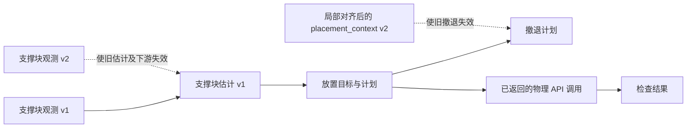

# Stack 图驱动执行反馈：第一版

入口 `capx.experiments.graph_feedback` 复用现有 P0 Snapshot、父进程 API broker、Bubblewrap、L0–L3、DeepSeek Provider 和独立物理评分。它是显式启用的实验入口；原推理路径保留。只适用于模拟 Stack 的 Structured Vision，模型接收文本和工具结果，不直接看图。实现、真实试验与限制见 [原型实验报告](../reports/capx-graph-feedback-prototype-2026-11-20.md)。

## 先验收机制：无服务、无模型费用

从正式项目执行。输出目录必须不存在，入口拒绝覆盖。

```bash
cd /home/hanyu/dqb/cap-x-20261106
export PYTHONDONTWRITEBYTECODE=1 OPENBLAS_NUM_THREADS=1 OMP_NUM_THREADS=1
.venv/bin/python -B -m capx.experiments.graph_mechanism \
  --output "outputs/reproduction/graph-mechanism-$(date +%Y%m%d_%H%M%S)"
.venv/bin/python -B -m pytest -p no:cacheprovider tests/graph_feedback -q
```

最终本地图反馈测试为 **175 passed / 0 skipped / 0 failed**，结果见 `outputs/reproduction/graph-feedback-20261120/graph-import-order-final.xml` 和同名日志。

机制入口对 G0/G1 分别验证 `support_refresh` 和 `local_alignment`。它使用真实隔离 actor 和生产图监控，但 API、编码器及表面估计为确定性的公开观测 Mock。每例先阻断旧动作，再由新 actor 重算后继续，最后用第三个 actor 尝试重放已完成动作并验证拒绝。产物明确记录 `online_vision=false`、`llm_requests=0`、`physical_reward=null`。这不代表在线感知或物理任务成功。

## DeepSeek + 在线视觉配对

先按 [现有运行说明](README.md#运行) 配好服务及本机渲染环境。保留 `.env.local`、`.env.api.local`，密钥仍由 `common.sh` 加载，不写入命令行。模型须配置为 `deepseek-v4-pro`；程序不自动替换模型。

```bash
source scripts/local/common.sh
export PYTHONDONTWRITEBYTECODE=1 OPENBLAS_NUM_THREADS=1 OMP_NUM_THREADS=1
: "${SAM3_SERVICE_URL:?请先设置已核验的 SAM3 服务地址}"
: "${GRASPNET_SERVICE_URL:?请先设置支持 Seed 回显的 GraspNet 地址}"
: "${PYROKI_SERVICE_URL:?请先设置原 CaP-X 求解器的 IK 地址}"

.venv/bin/python -B -m capx.experiments.graph_feedback \
  --output "outputs/reproduction/graph-smoke-$(date +%Y%m%d_%H%M%S)" \
  --snapshot-manifest outputs/reproduction/layered-feedback-20261119/scene-bank/paired-scenes.json \
  --seeds 2027 --groups G0 G1 --faults none support_refresh \
  --max-requests 10 --cost-limit-usd 4 --wall-seconds 3600 \
  --max-tokens 32768 --reasoning-effort low --request-timeout 400 \
  --max-blocks 3 --api-budget 64 --max-local 2
```

服务地址来自环境变量，也可通过 `--sam3-url`、`--graspnet-url`、`--pyroki-url` 显式传入。入口不启动或停止服务。PyRoKi 不能只看接口是否兼容：复现应使用原 CaP-X 求解器，当前独立 CPU 实例的地址由原运行说明中的 runtime JSON 读取。

新增场景时省略 `--snapshot-manifest` 并指定新的 `--seeds`，既有 `prepare` 流程会静置、保存并校验重放；复跑历史 Seed 不算新增独立场景。`--groups G0` 或 `G1` 适合诊断，比较结果需要两组齐全。

`none` 不主动增加感知更新。`support_refresh` 在第一次 place 动作边界触发一次真实的支撑块重新定位，更新观测版本并阻断旧目标；它不移动物体、不注入真值，也不保证新旧坐标数值不同。是否实际触发记录在 `fault_fired`，没有走到该边界的 episode 不能算一次有效故障暴露。局部对齐失效由原 L2 释放前检查自然触发，在线实验没有为提高结果强行制造该修复。

## 复用历史真实初始程序

`--initial-run` 只复用已保存的真实 DeepSeek 初始响应，适合修复执行侧工程问题后以相同程序复跑。它不会复用旧恢复代码，也不会把历史请求计为本轮新请求。恢复仍通过当前 DeepSeek Provider 生成，可能产生费用。

在上面的服务环境设置后执行，下面使用本轮已经保存的两份初始程序及其原 Snapshot：

```bash
.venv/bin/python -B -m capx.experiments.graph_feedback \
  --output "outputs/reproduction/graph-replay-$(date +%Y%m%d_%H%M%S)" \
  --initial-run outputs/reproduction/graph-feedback-20261120/initial-cache-v4 \
  --snapshot-manifest outputs/reproduction/graph-feedback-20261120/scene-bank/paired-scenes.json \
  --seeds 2027 100003 --groups G0 G1 --faults none \
  --max-requests 8 --cost-limit-usd 4 --wall-seconds 3600 \
  --max-tokens 32768 --reasoning-effort low --request-timeout 400 \
  --max-blocks 3 --api-budget 64 --max-local 2
```

示例使用两份现有 `initial/seed-N-fault-none.json`，两对最多产生 8 次新的恢复请求。其他运行可将 `--initial-run` 替换为包含所选 Seed/fault 初始文件的目录，同时指定其原 Snapshot 清单；按实际文件调整 Seed/fault。入口先检查所有待复用文件，再执行：模型名称、完整结束状态、响应正文解析后的代码和代码 hash 都须相符；执行时继续严格核对 Snapshot、Prompt、API 文档、代码四个 hash。缺文件或不一致会停止，不会悄悄改发新初始请求。与 Prompt 有关的预算必须与历史运行一致。

原初始 JSON 按原字节复制到新目录，保留原请求 receipt 路径；旁边的 `*-cache-source.json` 记录来源、文件 hash 和 `generated_in_this_run=false`。历史目录应保留可读，否则离线分析无法补回原初始 Token/耗时。缓存模式下每对最多新增 `2 × (B−1)` 次恢复请求，默认三块为 4 次；全局上限仍生效。

## 恢复解析与零新增模型请求复跑

恢复响应仅有独立的 `FINISH` 才表示模型选择结束；它不设置物理成功。正常恢复格式为 `REGENERATE` 加一个完整的 Python fenced block。若只返回一个完整、可解析的 Python fenced block，缺少 `REGENERATE`，解析器允许这一种格式修复并记录 `format_repair=missing_regenerate_marker`；不会把缺标记的代码误当成 FINISH。多代码块、截断、冲突标记或额外混杂内容均拒绝。

`graph_replay` 用历史真实 DeepSeek 响应验证执行侧修复：重新恢复 Snapshot、运行真实在线视觉服务和仿真，**不发送新的 LLM 请求**。它与只缓存初始代码、恢复仍需调用模型的 `--initial-run` 不同。例如复跑 V4 的 Seed 100003 / G1 恢复解析问题：

```bash
.venv/bin/python -B -m capx.experiments.graph_replay \
  --source-run outputs/reproduction/graph-feedback-20261120/paired-regression-v4 \
  --output "outputs/reproduction/graph-recorded-replay-$(date +%Y%m%d_%H%M%S)" \
  --seed 100003 --fault none --groups G1 --wall-seconds 600
```

仍需按上文配置本机渲染环境。服务 URL、场景与执行预算从源运行配置读取；入口先设置服务地址再导入集成模块，不启动或替换服务。每次恢复的当前公开 Prompt 必须与源 `prompt.json` 逐项相等，且与原 `http.json` 中的 `payload.messages` 相符；原 receipt 的 HTTP 状态、模型和结束原因也须通过检查。任何漂移、缺失响应或重复消费都会停止，没有付费调用回退。

产物 `recorded-responses/` 保存原请求路径、响应和源文件 hash、两种 Prompt 匹配结果；summary 明确 `new_llm_requests=0`、`new_model_cost_usd=0`。这是“历史模型响应 + 新在线感知/物理执行”的诊断，消耗本地服务资源，也保留原模型生成成本；不能标作新 DeepSeek 在线生成或新增独立场景样本。若新执行需要历史中没有的下一次恢复响应，应报告证据不足，不补发请求。

本轮 `parser-replay-v6` 已实跑 Seed 100003 的 G0/G1：4 份历史恢复响应的 Prompt 与传输消息匹配，新增模型请求和费用均为 0。G1 缺失标记的完整代码已按格式修复实际执行，消除了误判 FINISH；两组最终物理 reward 均为 0，并在三个代码块预算后退出。这验证了解析修复与在线执行，不代表任务成功提升。两条视频共 67 帧逐帧解码、时间戳核验通过，10 份源码归档与最终冻结源码一致；详见 `outputs/reproduction/graph-feedback-20261120/parser-replay-v6-final-audit.json`。

## 公平比较及预算

| 项目 | G0：保守恢复 | G1：依赖图恢复 |
|---|---|---|
| L0–L3、释放前检查、撤退约束、拦截位置 | 相同 | 相同 |
| 初始程序、Prompt/API 文档、Snapshot、故障设置 | 每对完全共享 | 每对完全共享 |
| 失效后范围 | 正常更新清理全部旧计划/检查；真正中断或局部对齐废弃全部未执行后缀相关结果 | 沿声明的依赖传播，保留无关且仍有效的结果 |
| 给 DeepSeek 的代码证据 | 上一整块程序 | 图中相关片段；缺失时回退整块并记日志 |
| 恢复代码 | DeepSeek 生成，新 actor 执行 | DeepSeek 生成，新 actor 执行 |

每个 `(Seed, fault)` 只请求一次初始代码。若 `--max-blocks B`，两组各最多 `B−1` 次恢复，每对最坏请求数为 `1 + 2 × (B−1)`；默认三个代码块时为 **5 次**。`--max-requests` 是整批真实请求上限，不是 episode 数。共享初始请求的账单只支付一次；比较单组独立运行成本时，要给每组计入一次初始生成成本。

初始 Prompt 会按实际 `--api-budget` 和 `--max-blocks` 写入预算，恢复反馈继续给出剩余 API 次数和代码块数；默认分别为 64 和 3。局部恢复也扣除实际 API 预算；actor 另有每块 64 次 broker 调用、整个 episode 256 次 broker 调用和每块 90 秒期限。模型默认 32768 输出 token，明确 `reasoning_effort=low`，单请求不自动重试。只解析 `content`，拒绝截断或错误模型返回。

全局时间、费用或请求上限可提前结束整批；因此要核对两组均完成且预算一致。串行顺序导致全局资源耗尽时，尾部不完整配对须单独报告，不能计作图的优劣。不同 fault 之间会重新生成初始代码，不能当作严格的单一故障因果对照。

G0 的正常观测更新不应把同轮刚采集的其他输入清空：它按平面规则废弃全部旧 plan/check 与被替换的估计，保留同轮其他输入用于重新计算。只有真正的边界中断或局部对齐时才保守清空全部待执行后缀相关结果。G1 则按边关系确定失效范围。这样避免 G0 在连续读取红、绿方块时互相擦除输入，形成无法完成重规划的人为死循环。

## 图怎样参与执行

图使用普通字典和列表，Schema 为 `capx.execution_dependencies.v1`。节点包括带版本的观测/估计、计算后的运动计划、程序片段、API 调用和验证；边分 `data` 与 `precondition`。能力定义、RGB-D 数组、完整源码和物理日志独立保存，通过 ID、路径和调用行号关联。



模型使用 `observe_object`、`observe_grasp`、`read_robot` 得到结果 ID，向 `plan_motion` 明确登记计算依赖，再调用 `run_plan`。原始 `goto_pose`、`get_object_pose`、`sample_grasp_pose` 在这个入口被阻止，必须使用登记依赖与版本的契约 API。释放后首先要通过新撤退计划验证，不能把撤退改标为 approach 来绕过检查。一个 plan ID 至多消费一次，已返回的物理动作是历史事实，失效不能使其重新变成待执行动作。依赖不完整时采取保守失效。

局部对齐时，若夹爪处于闭合状态，旧红块位姿估计及其下游也会失效；它不能作为仍有效的持物位置交给恢复程序。

原子运动没有运动中取消接口，只在 API/技能边界阻断；异常时核对当前公开状态，不假设动作回滚。中断结束当前 actor，下一代码块新建隔离 actor；变量消失，物理场景保留。原 P0 的稳定物理评分不变，`FINISH` 和图检查 `PASS` 均不能自行判定任务成功。

## 证据与适用边界

- `experiment.json`：预算、服务地址、Git HEAD、关键源码 hash；`sources/`：对应源码的原字节排他归档，包含图执行器、父子进程执行器、原分层反馈、任务环境及物理评分，hash 来自归档的同一份字节，不包含 `.env`；`snapshot-source.json`：真实快照来源。
- `initial/`、`llm/`：真实模型输入、代码、内容、usage、HTTP 状态和响应 ID，无 API Key/鉴权头。
- `episodes/*/block-*.json`、`recovery-context-*.json`：每块源码来源、被选证据、恢复范围及回退标记。
- `graph-events.jsonl`、`graph-block-*.json`、`graph-final.json`：新增、版本更新、失效、消费、返回和重验证记录。
- `tools/`、`observations/`：实际在线工具输入输出与用于监控的公开 RGB-D/标定/机器人状态。
- 原 Trace 中的 `feedback_evaluation` 和 `evaluation-geometry.json`：仅供独立物理评价及离线诊断，不传入图监控或模型。
- `result.json`、视频及时间戳：原物理结果、阻断/恢复、API 数量、模型请求和耗时；`summary.json`：批次汇总。

图不是任意 Python 程序的数据流证明器。它依赖显式技能契约和模型登记的实际依赖；第一版只能核对必要的 ID 类型与状态，不能证明每个数值表达式都完整声明了来源。`valid` 表示相对已登记更新尚未失效，不表示估计无偏差。共享相机的表面估计也不是独立传感器证据。撤退检查只约束首个边界目标，不保证整段轨迹无碰撞。没有将 Mock 验收当作真实任务验收，也没有改为向模型提供仿真真值。

## 工程版本与回归范围

V3 的三批产物保留启动时的 `sources/`，后续源码变更不回写旧结果。V4 补齐普通 Python 异常和 API 参数校验异常的保守回退：当错误无法完整归因时，两组都废弃未执行后缀的待用结果，保留已完成物理调用的历史事实，交给新 actor 恢复。受控反馈只带错误类型，不转发可能含私有请求细节的原始异常文本。

V4 同时将抓取、抬升检查保留为 `verification_fact` 历史证据，并关联闭爪时的观测基线；历史 PASS 本身不授予下一动作权限。lift/place 边界重新登记当前公开机器人观测、原有持物/抬升许可条件及相关事实，形成新的前置检查。这没有增加仿真真值，也没有放宽原物理成功判据。V3 与 V4 应分别分析；V4 的真实回归结果以对应运行产物及最终报告为准，不能从实现存在推定有效。

## 离线分析

分析入口只读取产物，不调用模型、视觉服务或仿真。输出文件必须不存在：

```bash
: "${RUN:?请设置要分析的 graph_feedback 运行目录}"
.venv/bin/python -B -m capx.experiments.graph_analysis \
  --run "$RUN" --output "$RUN/analysis.json"
```

可用 `--run "$RUN_A" "$RUN_B"` 一并核算多个运行。分析器会标记不同源码/预算配置，不应把不同版本直接合并成同一次受控实验。`groups` 保留全部原始结果；因工程中止、基础设施故障、全局预算中止、配对缺失、hash 不一致、故障未在两组实际触发，或恢复协议误分类而排除的场景，不进入 `paired_effects`。旧结果中的 `model_finish` 若对应实际返回代码而非独立 FINISH，会标记 `recovery_protocol_misclassification` 并排除整对；原始结果和已发生费用仍保留。V4 使用 `final-v4-audited-analysis.json` 的修正口径，不能继续引用旧未审计统计作为有效配对结果。

`billing` 仅统计所选运行目录中实际记录的请求，路径去重。外部缓存的历史初始请求不计入本轮账单；各组 `logical_llm` 仍计入一次初始生成，以估算单组独立运行成本。若还选入历史运行目录，其真实请求只计一次。缓存输入优惠单独核算，reasoning token 已包含在输出 token 内，不重复收费；缺 usage 的请求保留未知费用及预算预留，不能按免费处理。费用是按项目记录费率计算的估算，不是服务商账单。
