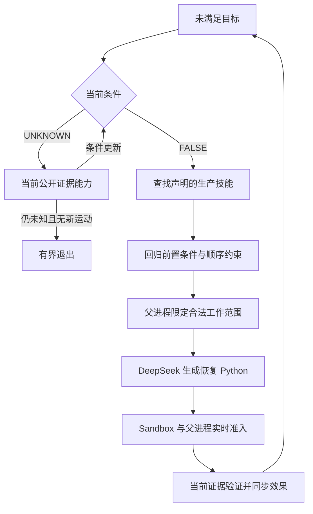

# V27 有界恢复与真实模型消融

使用正式项目已有 `.venv`、密钥和服务配置；不安装新依赖。所有输出必须是新目录。

```bash
cd /home/hanyu/dqb/cap-x-20261106
source scripts/local/common.sh
RUN="$PWD/outputs/model_comparison/v27_$(date +%Y%m%d_%H%M%S)"
.venv/bin/python -B -m capx.experiments.contract_models \
  --config env_configs/graph_feedback/development-v27.json \
  --seed 7 --ablations no_graph_repair no_selective \
  --output "$RUN/normal-seed7"
```

这会真实调用 DeepSeek，生成一次共享初始 Python，并串行运行 G0、G1、G1-no-graph-repair、G1-no-selective。恢复代码也来自真实 DeepSeek；父进程没有安全工作时直接退出，不为重试而付费。

证据过期和物理扰动是独立压力实验：

```bash
.venv/bin/python -B -m capx.experiments.contract_models \
  --config env_configs/graph_feedback/development-v27.json \
  --seed 0 --study evidence_expiry --ablations no_graph_repair no_selective \
  --output "$RUN/evidence-expiry"

.venv/bin/python -B -m capx.experiments.contract_models \
  --config env_configs/graph_feedback/development-v27-local-stress.json \
  --seed 0 --study effect_displacement --ablations no_graph_repair no_selective \
  --output "$RUN/physical-disturbance"
```

局部物理扰动使用 `development-v27-local-stress.json`：评估侧按物体质量和配置的速度增量计算外力，并保存前后私有评分；执行器仅看到证据失效及后续真实公开观测。必须检查原生目标是否实际被破坏，不能把故障名称当作成功注入证据。没有重置或直接设置物体位姿。

原基础配置的固定 6/12 N 外力仅用于复现已归档的极端压力记录：它曾将轻物体抛离工作区约 30.35 m，不能用于局部恢复结论。局部实验须使用上述质量归一化配置；在线执行器不会获得物体质量、外力或私有位置。

离线分析：

```bash
.venv/bin/python -B scripts/local/analyze_contract_models.py \
  "$RUN/normal-seed7" --output "$RUN/normal-seed7-analysis.json"
```

## 机制边界

- 共同底座：同一真实 Vision Skill、几何/抓持/目标区域/可达性检查、契约版本、Sandbox、独立物理评分和预算；最终释放阈值不变。
- G0：保守复核未完成后缀及目标，保留已完成兄弟目标，模型可选择所有合法候选。
- G1：Graph Executive 从未满足目标回归条件；UNKNOWN 先补证、FALSE 寻找声明的生产技能、没有合法能力时退出。父进程强制 `recovery_scope.allowed_intents`，模型不能扩大该范围。
- no-graph-repair：保留选择性证据范围和共同安全能力，关闭条件回归的执行授权，恢复工作由模型选择。
- no-selective：保留图恢复授权，补证改为保守全后缀范围。
- 已完成调用不可重放；修复创建新 ID；未知物理效果继续隔离。新的证据 ID 不等于进展。

没有立即可派发动作时，非图策略仍可通过 `evidence_allowed_intents` 请求尚未耗尽的合法补证，不会被当作“没有物理动作所以禁止模型观察”。G1 则由图选择补证目标及后续工作范围。两者都受证据预算、相同失败条件计数和跨 actor 无进展限制约束。真实机器人运动可以重新开放补证机会，重复静止拍摄或只新增来源 ID 不会。



工作范围不是释放许可；每次实际技能仍复核当前前置条件，底层释放仍检查完整几何区间。没有合格生产技能或未知在途效果时不构造猜测动作。图回归只使用声明的条件、生产效果与顺序约束，不根据任务名、对象名称、Seed 或压力事件分派动作。

配置中的 `contract_task` 旧副本已移除，运行时以 `region_task(..., grounded=True)` 生成唯一任务定义，实际定义与 API 文档保存于每个 episode。

当前只是单臂区域搬运能力的开发实验。附着冲突不能靠重置记忆或减小误差刷通过；缺少合格重估/安全卸载能力时保持 UNKNOWN 并退出。GraspNet 提供候选朝向，现有直立抓取原语使用当前几何中心及已有深度参数，并重新做碰撞/IK 检查；日志明确记录投影前后的位姿，不能宣称原始候选被原样执行。

每条命令上限见配置：24 次请求、项目估算 US$5、7200 秒；每 episode 6 个模型块、24 次 Skill、256 次 API、1200 秒。没有自动模型降级；新目录不会覆盖旧记录。初始请求跨组共用，费用合计须按请求 ID 去重。原 B0 与 V26 入口保留；本轮不把新的技能执行器冒称 B0。
