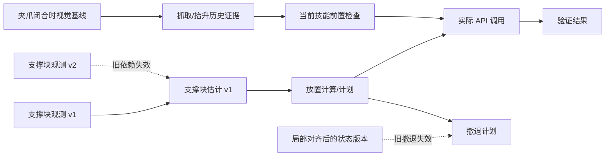

# CaP-X 图驱动执行反馈原型与小规模配对实验

日期：2026-11-20。正式目录 `/home/hanyu/dqb/cap-x-20261106`；分支 `feature/graph-feedback-20261120`；起始 HEAD `823b878e2dc010e3ec0f3683c9f846ffb97fa17c`。原工作区已有大量未提交修改，本轮保留；不能把整个 `git diff` 当作本轮修改。

产物根目录：`outputs/reproduction/graph-feedback-20261120/`。下文的运行目录名称均相对此目录；关键证据见 [V3 汇总](../../outputs/reproduction/graph-feedback-20261120/final-v3-analysis.json)、[逐例诊断](../../outputs/reproduction/graph-feedback-20261120/v3-diagnostic.json)、[机制验收](../../outputs/reproduction/graph-feedback-20261120/mechanism-v6/summary.json)。

## 结论

依赖图已进入父进程执行路径：新观测替换、局部对齐会使下游计划失效；失效动作在 API 边界被阻止；恢复由新 Sandbox actor 执行，已完成调用不会自动重放。G0/G1 使用同一验证器、技能契约、初始程序及物理评分，区别在证据选择和失效/恢复范围。

机制验收与真实在线试验分开记录。冻结 V3 的 4 对试验中，G0 成功 1/4、G1 成功 2/4；包含 3 个不同场景，其中 2 个为项目历史产物之外的新场景，新场景两组均为 0/2。只有一个配对的最终成功结果有利于 G1，不能宣称统计提升。两组均观察到视觉基线缺失、放置估计偏差和恢复程序错误。

V3 运行暴露了普通程序异常未保守清理、技能失败证据未完整连接的问题。修复形成 V4，并复用真实 DeepSeek 原初始响应复跑代表场景；随后发现一个完整恢复程序被旧解析器误判为 FINISH，已修复、排除受影响配对，并以保存的真实响应完成零新增请求的在线回归。不同源码版本、真实模型生成与保存响应重放均分开报告。

## 实现范围

| 文件 | 本轮作用 |
|---|---|
| `capx/execution/dependency_graph.py` | 普通 Python DAG、版本、数据/前置条件边、反向诊断、下游失效、一次消费及完成事实 |
| `capx/execution/graph_feedback.py` | 继承已有 L0–L3，在父进程 broker 登记观测/计划/技能契约，阻断旧计划并组织恢复上下文 |
| `capx/execution/actor.py`、`sandbox.py` | 仅增加可信 API 调用点行号/源码来源；保留回调接口和隔离权限 |
| `capx/experiments/graph_feedback.py` | 真实 DeepSeek 配对入口、共享初始代码、Snapshot 恢复、新 actor、预算与源码归档 |
| `capx/experiments/graph_mechanism.py` | 确定性状态更新和边界恢复验收，明确 Mock 感知、真实 Sandbox |
| `capx/experiments/graph_replay.py` | 严格匹配原 Prompt 与 HTTP messages，复用真实模型响应做在线感知/物理诊断，不发起新 LLM 请求 |
| `capx/experiments/graph_analysis.py` | 只读配对、成本、Token、重复调用与失效记录统计 |
| `tests/graph_feedback/` | 图、契约、调用点、Runner、缓存、分析、普通异常及技能证据测试 |
| `docs/feedback/GRAPH.md`、`docs/feedback/README.md` | 配置开关、运行/复跑命令和能力边界 |

原 `feedback.py`、`audited_stack.py`、`physical_evaluation.py`、`layered_feedback.py` 与本轮 baseline hash 一致。原验证阈值、稳定物理成功判据、Provider 和 Snapshot 实现未改变。没有升级依赖、下载模型、训练或操作真实机器人。

## 图怎样控制执行



模型通过 `observe_object`、`observe_grasp`、`read_robot` 获取 ID；`plan_motion` 登记实际使用的结果 ID；`run_plan` 消费一次计划。原始运动/定位 API 在该实验入口受契约包装，不能绕过计划检查。任意 Python 仍在原 Sandbox 内整体执行，没有按行切割程序。

G1 从异常节点向前追溯证据和实际调用片段，再沿无效依赖向后确定需要重新观测、计算和检查的范围。G0 不依据边选择保留项，真正中断后清理全部未执行后缀；正常重复观测只清理旧计划/检查及被替换输入，避免连续读取红/绿方块时互相清空新输入的人为死锁。

已返回调用是不可逆的历史事实，计划一次消费后不得重用。V4 的 `verification_fact` 也只是历史事实，不能当作当前动作许可；新动作须经过当前前置检查。新一次闭合会清除旧抬升证据指针。未捕获的普通 Python 异常、未知依赖及契约错误采用全后缀保守恢复，不重放已完成物理动作。

原子运动接口没有在途取消能力；本版只在 API/技能边界介入。异常保留 returned / unknown-partial-effects 等状态，新 actor 开始前读取当前公开机器人/视觉状态，不假设回滚。

在线输入只有 RGB-D、相机标定、机器人编码器/TCP 和实际视觉服务输出。仿真物体真值在独立评价日志中记录，只用于离线误差分析；图监控及 DeepSeek 不读取该日志。`FINISH`、图检查 PASS 与物理成功严格分开。

## 机制验收

`mechanism-v6/summary.json`：4/4 通过，全部使用真实 Bubblewrap actor，公开感知和机器人状态为确定性 Mock，LLM 请求 0、物理 reward 为 null。

| 更新事件 | G0 | G1 |
|---|---|---|
| 支撑观测更新 | 旧 place/retreat 失效、旧动作未发出、重算后继续 | 相同行为，且无关抓取结果仍有效 |
| 局部放置对齐 | 旧 retreat 失效，需新撤退验证 | 相同行为，且无关抓取结果仍有效 |
| 第三个 actor 尝试旧动作 | 拒绝 | 拒绝 |

两例的旧 place=`n000050`、retreat=`n000052`、已完成 lift=`n000040`、无关 grasp=`n000024`。支撑更新例实际底层 API 次数 G0=13、G1=11；局部对齐例均为 11。此处只证明机制有效，不能作为在线任务成功率证据。

## 真实在线实验设置

运行真实 DeepSeek `deepseek-v4-pro`，文本输入，Structured Vision 通过真实 SAM3、RGB-D 和 Seeded GraspNet；不是模型直接看图，也没有 Oracle 冒充模型代码。输出上限 32768，`reasoning_effort=low`，只解析 `content`，reasoning 单独记录；单次请求不自动重试，超时 400 秒。每 episode 3 块代码、64 次实际 API、每块 90 秒、每个释放检查最多 2 次局部对齐。

每对共享 Snapshot、初始 Prompt/API 文档与 DeepSeek 初始代码，四项 hash 都核对。V3 四对初始实际 API 名称、参数、返回和物理前后状态逐项一致，初始块 API 长度依次为 11、9、7、8。每组恢复代码仍由模型生成，随机性保留；不同 fault 的初始代码不相同，不能跨 fault 当作单因素对照。

`support_refresh` 是第一次 place 前的一次真实支撑块重新定位，不注入位姿偏移或仿真真值；验证观测版本更新是否能阻断旧目标。两对故障在 G0/G1 中均实际触发。局部对齐由原 L2 自然触发。

## 配对结果

冻结 V3：每格为「原 reward / 实际 API 次数 / 恢复请求次数」。成功必须同时满足原执行状态与独立物理判据；物理状态曾短暂成功不等于该 episode 成功。

| 场景 / 更新事件 | G0 保守恢复 | G1 图恢复 |
|---|---:|---:|
| 2027 / 无主动故障 | 1 / 13 / 1 | 1 / 12 / 1 |
| 2027 / 支撑重新定位 | 0 / 21 / 2 | 1 / 15 / 2 |
| 100003 / 无主动故障 | 0 / 14 / 2 | 0 / 11 / 2 |
| 100019 / 支撑重新定位 | 0 / 16 / 2 | 0 / 14 / 2 |

| V3 指标 | G0 | G1 |
|---|---:|---:|
| 成功 episode | 1/4 | 2/4 |
| 实际 API 次数 | 64 | 52 |
| 重复定位调用 | 14 | 6 |
| 恢复请求 | 7 | 7 |
| 失效节点数之和 | 329 | 41 |
| 分组逻辑 input / output token | 89,834 / 97,190 | 70,632 / 85,423 |
| 分组逻辑 reasoning token（已含在 output） | 91,917 | 81,135 |
| 估算独立运行平均墙钟耗时 | 353.0 s | 303.1 s |

逻辑成本/耗时把共享或历史初始请求计入每个策略，以估计单独部署的代价；不等同于本轮实际付费总额。失效节点数只说明恢复范围，不是正确率。两组恢复请求数相同；API 减少同时受证据复用和随机生成的程序差异影响，不能全部归功于图。

V4 工程回归另列，不能与 V3 合并：

| 场景 | G0 原结果 | G1 原结果 | 效果比较资格 |
|---|---|---|---|
| 2027 / 无主动故障 | 成功，13 API，1 次恢复请求 | 成功，12 API，1 次恢复请求 | 有效配对 |
| 100003 / 无主动故障 | 失败，14 API，2 次恢复请求 | 失败，10 API，2 次恢复请求 | 排除：G1 最后完整代码因缺标记被旧解析器误判 FINISH |

V4 两组原始账面均为 1/2，但修正审计后只剩 2027 一个可比较配对，双方成功。100003 的奖励没有被误判为正分；问题是有效恢复代码未执行。见 [V4 审计汇总](../../outputs/reproduction/graph-feedback-20261120/final-v4-audited-analysis.json)。

## 主要案例与证据

**2027 / 无主动故障：局部修正后安全撤退。** 初始放置的离线物理底部间隙约 42 mm，在线视觉估计为 48.1 mm；经原 L2 对齐后已经形成物理堆叠，但旧 retreat 计划过期，两组均在发出旧撤退前中断。初始块物理 success=true、原 reward=0；新的 DeepSeek actor 使用当前 TCP 重新规划垂直撤退后，两组原 reward 才变为 1。G0 比 G1 多的一次调用是模型额外 `home_pose`，不能归因于图复用。

**2027 / 支撑块更新：V3 的一个正向恢复例。** 第一块相同 9 次实际 API 后，旧 place 被阻止。G1 两次重规划后成功，G0 三块用尽仍未释放。G0/G1 API=21/15，其中 4 次差异来自额外两组红/绿定位，另外 2 次来自不同恢复/对齐/回位程序。G0 最后视觉 XY 偏差约 27.3 mm，离线物理 XY 约 6.4 mm、间隙约 −3.5 mm，说明视觉检查偏保守；不能据此断言直接释放一定成功。

**100003 / 新场景：抓取抬升成功，但验证缺少基线。** 初始闭合时红块被遮挡，视觉基线为 null；后续真实抓取和抬升并未滑落，现有 L2 却无法计算 `red_surface_rise`，一直 UNCERTAIN。V3 G0 在两次恢复中继续抬高，最大真实抬升约 0.720 m；G1 最大约 0.267 m，仍无法通过 place 前置条件。V4 将缺失基线与 grasp/lift 检查连接到异常节点，并不放宽原 L2 规则。真实 HTTP 反馈已包含基线缺失，但模型仍尝试继续抬升；仅补图中的证据连接不能解决不可见基线。

**100019 / 新场景与支撑更新：放置估计和恢复策略双重问题。** V3 两组均保守退出。G0 局部对齐后视觉 gap 约 1.4 mm、物理 gap 约 −7.3 mm，但视觉 XY 仍超阈值；下一块表面不可见。G1 一次对齐后视觉 gap 14.75 mm、真值 5.77 mm；最后恢复代码又执行 `close_gripper`，重置抬升状态却未再次完成 lift，随后 place 被阻止。这是模型新恢复程序的多余动作，不是框架自动重放已完成计划。

V3 全部 8 个 episode 均无重复消费同一 plan、无重复返回同一 call、无已完成 call 被清为待执行。没有观察到不需要恢复的正常完成案例；本轮轨迹覆盖恢复成功和预算内无法恢复退出，不补造缺失类别。

## 工程修复与版本说明

早期 `smoke-v1` 的 G0 连续重感知失效死锁被主动终止并修复；`paired-historical-v2` 暴露局部对齐后仍保留旧持物位姿的问题，修复后重新执行 V3。两批保留原始产物与费用，排除效果比较。

V3 结束后新增测试并修复 V4：父进程契约 ValueError/TypeError 转为不可在 actor 内吞掉的边界中断；未捕获的 Python 程序异常在代码块返回后保守清理。技能失败增加闭合基线、历史证据与当前前置检查边；三块用尽明确记录 `episode_code_block_budget`。未修改反馈阈值或奖励。V4 原初始响应按字节复制，恢复代码为新的真实请求。

最终又修复了两个执行入口问题：

- 旧多轮解析器将未带 `REGENERATE` 的完整 Python 代码默认当成 FINISH。新图入口只接受独立 `FINISH` 作为结束；单一完整代码块记录 `missing_regenerate_marker` 后执行，冲突/残缺格式拒绝。原全局解析器没有改动。V3 的全部恢复响应都有标记，不受影响；V4 100003 配对已排除效果比较。
- 部分集成模块在 import 时缓存服务地址。新入口延迟加载重依赖，确保 CLI/历史配置先生效，并增加全新 Python 进程测试。最初零付费重放 `parser-replay-v5` 因旧地址离线失败，完整保留；原真实实验在启动 Python 前已设置正确地址，不受影响。

最终解析修复验证：`parser-replay-v6` 的两个 episode 均完成，耗时 34.46 秒，4/4 历史恢复响应的当前 Prompt 与原请求完全匹配，**新增 LLM 请求与费用均为 0**。G0 三块后原 reward=0、实际 API=14；G1 原先遗漏的第三块现在真正执行，因 `approach_while_already_holding` 在 `run_plan` 边界被拒绝，没有派发额外运动，API 保持 10、原 reward=0。两组均以 `episode_code_block_budget` 退出，不再记录虚假的 FINISH。见 [复跑汇总](../../outputs/reproduction/graph-feedback-20261120/parser-replay-v6/summary.json)和[逐 API 物理一致性诊断](../../outputs/reproduction/graph-feedback-20261120/parser-replay-v6-diagnostic.json)。复跑只能消费当前公开 Prompt 与保存 Prompt、原 HTTP messages **逐项完全一致**的历史响应；缺失、偏移或重复消费均停止，没有付费回退。这是保存模型响应驱动的在线视觉/物理回归，不算新增真实模型样本或独立场景。V4 的六条恢复 Prompt 经重构均与原请求一致，见 [Prompt 审计](../../outputs/reproduction/graph-feedback-20261120/final-runner-prompt-proof.json)。

## 测试与请求费用

- 最终图框架与入口：**175 passed / 0 skipped / 0 failed**，[JUnit](../../outputs/reproduction/graph-feedback-20261120/graph-import-order-final.xml)、[完整日志](../../outputs/reproduction/graph-feedback-20261120/graph-import-order-final.log)。包括新进程导入/服务覆盖、严格响应解析、ID/失效/技能契约、异常、Prompt、配对和分析测试。
- 原 P0 + Provider Mock + 原分层反馈：**96 passed / 0 skipped / 0 failed**（60 + 8 + 28），[JUnit](../../outputs/reproduction/graph-feedback-20261120/p0-feedback.xml)、[完整日志](../../outputs/reproduction/graph-feedback-20261120/p0-feedback.log)。包括已启用的在线视觉集成测试。受保护业务模块之后未改变。
- 机制验收：**4/4**，公开状态 Mock + 真实 Sandbox，零模型请求；新旧 actor PID、被阻动作、无关节点保留和旧动作重放拒绝均有记录。
- V3/V4 的 12 条视频逐帧实解码共 **754 帧**；12/12 与 sidecar、严格递增仿真时间、result.info 和最终物理时间一致。[最终运行/视频审计](../../outputs/reproduction/graph-feedback-20261120/final-runtime-video-audit.json)同时保存源码归档、服务、密钥文件权限和敏感字段检查。 最后响应复跑的两条视频另解码 **67 帧，2/2 通过**，10 份归档源码全部匹配当前冻结版本，见 [复跑最终审计](../../outputs/reproduction/graph-feedback-20261120/parser-replay-v6-final-audit.json)。

| 真实请求范围 | 请求数 | Input token | Output token | 其中 reasoning | 峰时估算 USD |
|---|---:|---:|---:|---:|---:|
| V3 三个正式配对运行目录 | 16 | 150,635 | 143,451 | 136,782 | 0.729175 |
| V4 工程回归 | 6 | 69,461 | 41,789 | 39,075 | 0.247373 |
| 包含早期工程试跑的全部已知用量 | 32 个有用量记录 | 302,036 | 238,880 | 226,321 | 1.282751 |

另有早期被终止请求 1 条，用量未知，预留上界约 $0.176617，不能计为免费。全程共 33 个请求启动记录；32 个有响应/用量记录。全部记录的保守费用上界约 $1.521270；已知用量按非高峰估算约 $0.641376。计费汇总对共享初始请求去重，历史初始响应只在原请求中记账；零付费响应重放不重复计费。见 [完整账本](../../outputs/reproduction/graph-feedback-20261120/all-request-accounting-audited.json)。

价格按本轮核验的 [DeepSeek 官方价格](https://api-docs.deepseek.com/quick_start/pricing/)估算并考虑缓存命中；reasoning 已计入 output，不能二次相加。输出/思考配置参照 [Thinking Mode](https://api-docs.deepseek.com/guides/thinking_mode/)。最终费用以平台账单为准，未把预留费用当成实际扣款。

## 运行环境与剩余限制

复用现有 SAM3、Seeded GraspNet 和原 CaP-X CPU PyRoKi，未重启或停止其他项目服务。GPU 内核驱动/NVML 分别为 580.173.02/580.178，`nvidia-smi` 无法读取显存；现有已加载视觉服务仍在线。仿真以 Mesa 渲染真实 RGB-D，不是冻结感知重放。两份 API 配置权限仍为 0600，未纳入 Git；日志敏感字段扫描只检查字段名，不能视为所有可能文本泄密的形式证明。

1. 显式契约不能完整证明任意 Python 数值的数据来源。实际恢复代码出现过使用反馈常量却登记新观测 ID，以及用抓取四元数但只声明红/绿位置 ID。第一版核验必要 ID 类型、版本和状态，不能宣称完整程序数据流验证。
2. `valid` 只表示相对已登记更新尚未失效。已建模局部对齐导致持物位姿过期；普通动作对全部物体 SE(3) 状态的影响尚未完整建模。位姿和尺寸绑定保存也会造成失效过宽。
3. 同一相机的定位与表面验证共享遮挡/标定偏差；重复一次估计不等于独立确认。闭合时基线缺失仍可能让抬升验证无法恢复。
4. 撤退只验证首个垂直目标，不保证整段轨迹无碰撞；没有运动中取消接口。重复调用统计并不等同于无用调用。
5. 少量场景、随机恢复程序及串行运行不能给出统计显著结论。后续优先补对象状态变化契约和可重新建立的公开技能证据，再在固定源码上扩大配对场景；不要先放宽成功判据。

## 复跑入口

完整命令、服务配置与缓存复跑说明见 [运行文档](../feedback/GRAPH.md)。已有服务参数从环境或明确 CLI 参数读取；实现不固定本机端口。所有输出目录必须不存在，入口拒绝覆盖。

```bash
cd /home/hanyu/dqb/cap-x-20261106
source scripts/local/common.sh
export PYTHONDONTWRITEBYTECODE=1 OPENBLAS_NUM_THREADS=1 OMP_NUM_THREADS=1
# 先按 GRAPH.md 配置已核验服务与本机渲染环境。
.venv/bin/python -B -m capx.experiments.graph_feedback \
  --output "outputs/reproduction/graph-pair-$(date +%Y%m%d_%H%M%S)" \
  --snapshot-manifest outputs/reproduction/graph-feedback-20261120/scene-bank/paired-scenes.json \
  --seeds 2027 100003 --faults none --groups G0 G1 \
  --max-requests 10 --cost-limit-usd 4 --wall-seconds 3600 \
  --max-tokens 32768 --reasoning-effort low --request-timeout 400 \
  --max-blocks 3 --api-budget 64 --max-local 2
```

此命令会产生真实 API 费用。加入 `--initial-run outputs/reproduction/graph-feedback-20261120/initial-cache-v4` 可复用本轮真实初始代码；四项 hash 不符时停止，不静默请求新代码。`--groups G0` / `G1` 是配置开关；比较需要两组齐全。原 CaP-X CLI/Web 路径没有被这个实验入口替换。

修复后保存响应的在线复跑（不新增模型请求，仍需要视觉服务和仿真）：

```bash
.venv/bin/python -B -m capx.experiments.graph_replay \
  --source-run outputs/reproduction/graph-feedback-20261120/paired-regression-v4 \
  --seed 100003 --groups G0 G1 --wall-seconds 600 \
  --output "outputs/reproduction/graph-replay-$(date +%Y%m%d_%H%M%S)"
```

无模型费用机制验收：`.venv/bin/python -B -m capx.experiments.graph_mechanism --output NEW_DIR`。离线汇总：`.venv/bin/python -B -m capx.experiments.graph_analysis --run RUN_DIR --output NEW_ANALYSIS.json`。
