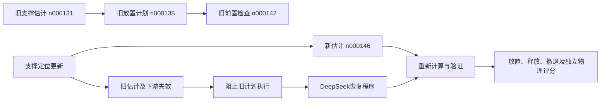

# 图反馈 V20：共同底座回归与在线压力验收

正式工程 `/home/hanyu/dqb/cap-x-20261106`，分支 `feature/graph-complete-20261120`，Git HEAD `823b878e2dc010e3ec0f3683c9f846ffb97fa17c`；已有未提交工作保留。执行源码以各实验归档和哈希为准。本报告是开发进度，**不是完整正式评测交付或图优越性结论**。

> 后续状态核实（2026-11-22）：V20 已完整结束，120/120 unit、360 episodes；B0/G0/G1 策略成功分别为 62/120、75/120、74/120，所有 API 失败保留。请求账本有 75 个 HTTP 402，不能将这批结果当成 360 次有效控制执行。G1−G0 为 −0.83 个百分点（场景聚类 95% CI −2.50 至 0.00），未显示图收益。以下“正在运行”描述保留为当时进度；最新修复及阻塞见 [V21 报告](graph-feedback-v21-2026-11-22.md)。

## 本次变更

- `capx/execution/grounded_feedback.py`：技能入口及实际物理 API 派发前，用当前公开夹爪开度否定已经丢失的抓持。旧版会先运动再处理空夹爪；现在阻止该未执行动作，复用现有抓持丢失逻辑清除当前持物身份，给新 actor 重新感知/重抓提示。缺失当前夹爪字段时也不发动作。正常开度本身不构成抓持成功证据。
- `tests/graph_v2/test_pre_action_grasp.py`：10项新回归，覆盖G0/G1、已验证/未验证抓持、释放前丢失、缺失/非有限状态、允许打开空夹爪、运动返回后丢失。
- `tests/graph_v2/test_grasp_loss_state.py`：保留原有运动后丢失断言，将模拟滑落时机移至运动返回之后；与新动作前测试分开。
- `env_configs/graph_feedback/development-v20.json`：沿用V19模型、服务和所有预算，仅说明新版本。README更新版本与16代码块对应的调用上限。

G0/G1共用修复。未改原物理成功判据、Sandbox、依赖或服务；没有训练、下载模型或操作真实机器人。修复前源码、diff、先失败的测试和保护哈希见 `outputs/reproduction/graph-complete-20261120/pre-action-grasp-v20/`。

## 验证

新增测试先得到7失败/3通过，再改业务代码。针对性34项通过；全图回归1075 passed/6 skipped，随后六项真实MuJoCo渲染测试全部通过，合计1081个不同图测试通过；另有原L0–L3测试28项通过。没有通过修改成功判据或跳过真实失败来达标。缺失夹爪字段在旧逻辑中还会导致运动后的IndexError，本次改为派发前的可恢复中断。

SAM3、GraspNet、PyRoKi的Schema/健康接口均在线，GraspNet支持Seed；复用原进程，没有重启。NVML驱动不匹配仍阻止读取显存，不能宣称GPU驱动问题已解决。只读清单在 `outputs/reproduction/graph-complete-20261120/preflight-v20-20261122/`。

## 真实DeepSeek＋Vision压力配对

使用历史Stack seed202611201固定Snapshot，DeepSeek V4 Pro真实生成初始与恢复程序，实际SAM3/RGB-D/GraspNet及PyRoKi执行。每项内部G0/G1共享初始程序、Snapshot、API文档、模型和预算；两项独立生成，不能跨项当同一初始程序。max_tokens32768、reasoning low、16代码块、192实际API、24局部恢复、8视角调整、2400秒episode。动作中取消不可用，仅在API/技能边界干预。

|压力条件|组|原reward/策略成功|LLM重规划|实际API（含感知）|物理修正/证据采集|配对端到端秒|
|---|---|---|---:|---:|---|---:|
|支撑定位更新|G0|1 / 是|2|14|3 / 2|180.84|
|支撑定位更新|G1|1 / 是|2|14|3 / 2|195.34|
|放置目标X偏移25mm|G0|1 / 是|2|17|4 / 2|124.93|
|放置目标X偏移25mm|G1|1 / 是|3|17|4 / 2|241.60|

所有故障均实际触发，四个episode源码后检查均369文件不变。共11个去重真实请求，输入169,514、输出45,997 token，其中reasoning43,739已含在输出内；现有记录价目费用上界估计$0.40590660，非服务商账单，未知用量0。G0/G1初始请求只收一次；上表两边端到端时间都包含共享初始生成，实际墙钟费用另见账本。

定位更新例中，G1的旧支撑估计n000131变更使放置计划n000138及前置检查n000142失效，新估计n000146并未自动授权旧计划。后续由DeepSeek重新获取需要的当前证据、计算新计划，完成放置与撤退。G1恢复上下文使用dependency_slice/affected_dependencies；G0使用full_block/all_unexecuted_suffix。完成调用在所有失效事件后仍是历史，不会变回待执行动作。



偏移例中，释放前公开几何不足触发UNCERTAIN，释放被阻止；重新规划后才得到PASS并释放成功。不能把这一过程虚称为全程自动局部对齐：这里确实调用了模型恢复。实际物理修正、补观测、LLM恢复各自的事件与离线前后状态分开保存。图保留节点的数量也不等于节省的调用次数。

四个episode中，独立离线分析共有64个可标注检查点（定位更新13×2、目标偏移19×2）；这是选定L1/L2检查的覆盖，不代表所有反馈事件都有准确率标签。依赖保护、程序片段等不宜用物理成功标签强行分类。这64个检查点的离线标签为50次正确放行、14次正确阻断，没有观察到错误放行/误阻断；不能外推成整个系统100%准确。14次物理修正中12次消除了对应已标注风险，另外2次未奏效（定位更新的G0/G1各一次TCP修正），保留并计入成本。逐项标签见完整readout，未用最终reward反推检测准确性。

产物：

- `outputs/reproduction/graph-complete-20261120/stress-support-refresh-v20/`
- `outputs/reproduction/graph-complete-20261120/stress-target-shift-v20/`
- `outputs/reproduction/graph-complete-20261120/pre-action-grasp-v20/stress-readout/`
- `outputs/reproduction/graph-complete-20261120/pre-action-grasp-v20/stress-mechanisms/`

这些结果证明机制及真实恢复闭环可执行，**没有显示G1节省调用或提高成功率**。仅一个历史场景、两种压力条件，无总体效应置信区间。此前V19两个Restack场景为G0 2/2、G1 1/2，完整失败保留；跨版本不能合并成冻结效果估计。

## 固定开发与正式评测状态

`outputs/model_comparison/graph_final_v20_20261122/`保存三任务分配：Stack、Lift、Restack各20个新开发场景、每场景两次独立初始生成、B0/G0/G1共360 episodes。候选正式集各100新场景、共1800 episodes，尚未开始。历史323个已见Seed与候选360个场景无交集。

60/60开发Snapshot已重放验收，失败0、准备阶段模型请求0。开发配置及430项来源已冻结（签名`536fb802bcd98ef87776f0a90699a60586974243f3d85d5baa3d6b7fc3318e73`），360-episode开发批次已实际启动，日志为`development-run-foreground.log`。首个分离式shell未存活，审计确认当时0请求、0已开始unit，随后用受管长运行会话正常启动，没有重放任何已执行请求。批次停止或完成后自动保存状态和离线分析；不会自动将部分结果当成正式GO。开发阶段失败、预算耗尽及系统异常均保留；不按成功选场景。不在正式集上调参。完整开发结果与功效/时间/费用/磁盘检查通过后，才冻结正式规模与配置；当前**正式评测NO-GO（开发批次未完成）**。

首个运行检查点已完成2/120个unit、6/360个episode（同一新Stack场景的两次独立初始生成）。三组6次均物理与策略成功、0次LLM重新规划；G0/G1仍各有4次合计的局部干预（含补观测，不能说完全无需恢复），源码后检查均370文件不变。仅1个独立场景，不能推断总体成功率。批次继续运行，检查点保存在`initial-operational-check.json`。

查看进度和实际后续命令：

```bash
cd /home/hanyu/dqb/cap-x-20261106
bash scripts/local/graph_experiment.sh status \
  --campaign outputs/model_comparison/graph_final_v20_20261122/development
# 只在已停止且没有未知在途请求时续跑，勿并行启动第二个runner：
bash scripts/local/graph_experiment.sh resume \
  --campaign outputs/model_comparison/graph_final_v20_20261122/development
```

运行中的runner不修改业务、提示词或分析源码。完整冻结、正式样本量、消融与验收规则沿用 `docs/feedback/graph-v2.md` 和 `docs/reports/graph-final-campaign-operations-draft-2026-11-20.md`。当前大规模效果、置信区间和图本身的增益仍待固定开发及正式结果。
