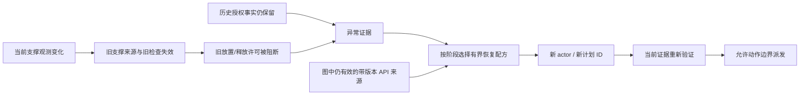

# Graph V21：动作准入、有界恢复与验收

后续状态：用户恢复 DeepSeek 额度后已继续真实在线实验，并修复 V21.2 桌面恢复选择问题，见 [在线续跑报告](graph-feedback-v21-online-resume-2026-11-22.md)。下文保留当时 HTTP 402 与历史程序诊断结果。

正式目录 `/home/hanyu/dqb/cap-x-20261106`，分支 `feature/graph-complete-20261120`，基准 HEAD `f1ecacb4fb0b1e5b9f56ddc2bbbd796f83e023e4`。本轮修改保留在工作区。V20 冻结开发批次已完整结束（120 unit / 360 episodes），没有运行中的冻结批次需要停止；历史源码归档、数据、密钥配置及实验结果保留。

**正式评测仍为 NO-GO。** 已实现共同准入修复和有界恢复，并完成本地回归及历史 DeepSeek 初始程序＋真实在线 Vision 的诊断重放。新 DeepSeek 请求返回 HTTP 402，未得到新初始程序或 LLM 恢复输出；没有将历史程序重放充当新的 DeepSeek 端到端实验，没有启动新的 360-episode 开发批次或正式 1800 episodes。

## 修改文件

- `capx/execution/grounded_feedback.py`：最终释放许可、同帧释放证据、分阶段依赖检查、技能意图与返回记录、分项计时。
- `capx/execution/grounded_recovery.py`：共享有界恢复配方、G0/G1 来源选择、实际复用与进展记录。
- `capx/experiments/graph_v2.py`：复用原多轮 runner，先运行已覆盖恢复配方，再进入 DeepSeek；保留新 actor、原预算和独立评分。
- `scripts/local/replay_graph_initial.py`：明确标识的历史模型程序诊断入口，复用原 runner，不构造 LLM 客户端。
- `env_configs/graph_feedback/development-v21.json`：恢复开关及上限，沿用现有模型、服务、评分和执行预算。
- `tests/graph_v2/test_dispatch_permission_v21.py`、`test_bounded_recovery_v21.py`：新增边界、恢复、来源契约、runner 与预算回归；`test_inflight_invalidation.py` 只将原 fixture 参数化为 G0/G1，未删除旧断言。
- `README.md`、`docs/feedback/graph-v2.md`、本报告；V20 报告加完成状态说明，旧实验内容保留。

## 修复证据

|问题|旧行为|当前行为/证据|
|---|---|---|
|最终 capture 后释放许可失效|历史授权节点不可变，仍派发 open_gripper|最后观测后检查原许可仍有效，再用当前 held/support 验证；两组均零释放派发，仍持物|
|多段 place 支撑完全不可见|跳过 None，记录 PASS 并继续|UNCERTAIN，中断剩余后缀；已返回第一段仍是 done，未重放|
|部分遮挡|没有明确阶段契约|当前部分点与历史一致、当前/目标持物底面净空至少 50mm且非下降时，允许 ascend/above_target；最终下降和释放仍要求当前完整定位|
|桌面检查内部再次 capture|可能配对旧 held 与新 table|先完成桌面当前验证，再从同一最新画面生成 held 证据；反事实移动会阻断释放|
|图恢复误选诊断摘要|V21 初版把无版本的 pre_release estimate 当作 API surface 句柄|V21.1 仅选择正确版本键、latest、frame 和 epoch 的 API 来源；摘要仍可诊断，不能用于计划|
|恢复丢失原技能参数|默认重新规划参数|保留已声明的 gap/z_approach 或 retreat 参数，来源与计划 ID 重新绑定|

前两个用户报告的软件边界测试先在旧实现得到 **6 failed**；桌面再次采集补测先得到 **2 failed**。来源摘要误选与技能参数保留各有先失败再通过的回归。均不声称已发生真实物理事故。完整证据位于 `outputs/reproduction/graph-v21-boundary-recovery/`，包括 red 日志、JUnit、`mechanism-evidence/G{0,1}-{release,inflight-occlusion}.json` 的完整图和实际派发记录。一次中间条件性净空测试未通过、早期 runner Mock 计时兼容错误及受限环境字体缓存错误均在迭代记录中保留，未算作物理成功。

图不决定机器人动作的拓扑执行顺序。动作顺序来自已有 approach/lift/place/retreat 契约；已完成调用不可回到 pending。未知部分物理效果继续隔离，不凭图推测已完成。

## 恢复与预算

G0/G1 均提供支撑更新后补证重算、已释放后新撤退、未验证抓持的 verify_hold、抓持丢失后的当前场景重建与受约束重抓。G0 重新获取未执行后缀的来源；G1 按有效依赖复用。每 episode 最多 6 个自动配方，同一阶段/对象最多连续 2 次无进展；每份配方消耗既有 local attempt，实际动作/感知继续计入原 API、代码块和时间预算。新 actor 不重置阶段或额度。

`bounded_recovery_events` 区分 selected_sources 与实际被**新且已返回计划**使用的来源。`contract_calls`、原 `actual_api_calls`、观测文件、工具日志以及 `component_timing` 同时保留，不能将选择/保留节点数当成节省的调用数。恢复范围超出覆盖时仍使用原 DeepSeek 多轮接口；本轮因 402 无法真实验收该分支。诊断重放入口禁止新模型查询，走到此处会有界退出。

## 本地验收

- 全量图测试：`final-version.xml` **1093 passed / 6 skipped / 0 failed**。
- 六项 opt-in MuJoCo 渲染/Snapshot 回归：`render.xml` **6 passed**，原像素和 GL 状态保持检查通过。
- 最后针对性契约回归：`final-contracts.xml` **19 passed**，包含随后增加的参数保留测试。
- 以 classname/name 去重、用渲染结果替换跳过状态，合计 **1100 个不同图测试通过**；见 `test-summary.json`。不是将重复执行累计成样本量。
- 原 L0–L3：`layered.xml` **28 passed**。
- 原物理评分、AuditedStack、任务 runtime、Robosuite Stack/Lift 评分、Sandbox 与 actor 字节均与 V20 冻结记录一致，见 `protected-source-check.json`。没有修改依赖、模型或真实机器人接口。

## 运行服务与新 API 请求

SAM3、GraspNet、PyRoKi 的实际配置端点均 HTTP 200；GraspNet OpenAPI 有 seed。复用现有进程，没有重启其他项目服务。NVIDIA 驱动查询仍失败，显存状态不可确认；宿主环境的既有 Mesa/EGL 路径可渲染。第一次受限执行环境初始化失败，模型请求 0；完整失败目录 `online-normal/` 保留，宿主复跑为 `online-normal-host/`。

后者唯一一次真实 DeepSeek 请求：deepseek-v4-pro、max_tokens 32768、reasoning low，HTTP **402 Payment Required**，0.572 秒、attempts 1。G1 复用失败初始记录，新增请求 0。没有自动循环请求或切换密钥/模型。usage 为空，不能伪造实际 token 数；账本保守预留上限 **$0.1445004**，不是实际账单。后续所有诊断新增模型请求/费用均为 0。`.env.local` 与 `.env.api.local` 仍为 0600，未记录 Key/鉴权头。

## 真实 Vision 诊断

全部使用固定开发集 Stack seed **953265258** 的同一 Snapshot，以及 V20 unit `7ec0118521e1e2a5ea2c` 的真实 DeepSeek 初始响应。逐次核对响应、程序 hash、API/Prompt/Snapshot hash，G0/G1 程序一致；SAM3、RGB-D、GraspNet、PyRoKi 和 Sandbox 均真实运行。局部恢复程序来自显式配方，**不是新 LLM 输出**。四个条件仍只有 **一个独立场景/一个初始生成**，不得计算总体成功率提升或置信区间。

初版 V21 的四组配对诊断共 8 episodes：7 成功，1 失败。目标偏移条件的 G1 因误选诊断摘要，连续两次无进展后要求 LLM，在禁止新请求的诊断中退出，reward 0；G0 成功。保留在 `replay-alignment/`，没有删除失败或用复跑覆盖。V21.1 修复在完整配对结束后进行。

V21.1 最终复跑 **8/8 episodes 原 reward 1 且策略成功**，全部源码后检查一致。只是四条件单场景机制诊断，不是八个独立场景。

|条件|组|恢复配方数|实际 API|RGB-D 采集|实际复用来源|本轮执行秒|
|---|---|---:|---:|---:|---:|---:|
|正常|G0|0|14|58|0|30.04|
|正常|G1|0|14|58|0|30.30|
|支撑版本更新|G0|1|14|66|0|32.14|
|支撑版本更新|G1|1|14|63|3|31.11|
|目标偏移25mm|G0|2|17|86|0|36.65|
|目标偏移25mm|G1|2|17|86|0|36.12|
|缺失抓持基线|G0|2|16|71|0|35.26|
|缺失抓持基线|G1|2|16|71|0|34.28|

“本轮执行秒”是 runner 的 total_seconds，包含仿真初始化/执行/保存，不包含历史初始请求的等待；配对预算另计原生成时间32.13秒。本轮没有实际 LLM 推理耗时。

支撑更新的 G1 新计划 `n000149` 实际使用 `n000135`（更新后支撑）、`n000117`（仍有效的持物来源）和 `n000125`（机器人来源），随后新撤退 `n000225` 返回。相对 G0，少执行两次 observe_surfaces 和一次 read_robot，改为三次 recall_result；RGB-D 采集66→63。实际工具/控制调用均14次，SAM3/GraspNet调用没有减少。单次运行32.14→31.11秒，差异不足以推断总体速度收益。

目标偏移例：初始释放为 UNCERTAIN（缺少当前支撑/持物证据），没有打开夹爪；第一次补证仍受遮挡阻断且没有物理派发。第二个配方从当前机器人状态作受约束的80mm上移，再重新观测、建立新放置计划、释放与撤退。G1最终公开检查的XY误差0.277mm、gap4.752mm，独立原reward为1；这些公开估计不是仿真真值，也不是独立传感器证明。G0走同一恢复能力、同样成功，图在此条件未减少调用。

缺失基线例：不重复close或lift，verify_hold进行20mm共动探测并返回；G1视觉测得位移[18.954,0.162,-0.093]mm，验证后继续放置，原reward为1。两组各多2次实际API（14→16），图未显示调用优势。

独立离线分析（不进入在线反馈）在所选L1/L2检查覆盖内共122个可标注检查：102正确放行、18正确阻断、2误阻断、0观察到的错误放行。两次误阻断均来自缺失基线：物理上已经抬升并双指接触，但公开历史基线被故障移除，系统保守请求共动验证。这是信息不足的代价，未用仿真真值绕过。其他依赖/程序检查并非都有物理标签，不能宣称全系统检测准确率；这些重复检查也不是独立统计样本。

分项耗时（秒；控制含IK，工具网络时间另在tools日志内、不可重复相加）：

|条件/组|RGB-D/几何/存储|感知API|控制|监控调度|
|---|---:|---:|---:|---:|
|正常/G0|5.81|1.48|16.15|2.82|
|正常/G1|5.70|1.50|16.84|2.77|
|支撑版本更新/G0|6.67|1.52|16.92|3.01|
|支撑版本更新/G1|6.21|1.54|16.76|2.86|
|目标偏移25mm/G0|8.63|1.46|18.35|3.88|
|目标偏移25mm/G1|8.34|1.46|18.41|3.80|
|缺失抓持基线/G0|7.18|1.50|18.51|3.15|
|缺失抓持基线/G1|6.92|1.50|18.05|3.13|

完整原始状态/工具/图/视频在各 `replay-final-*/episodes/G{0,1}/`；逐检查离线标签与全部16个新旧诊断episode见 `readout-final.json`。第一次 G1 失败及其2次无进展配方没有被复跑成功覆盖。

支撑刷新是实际重新感知产生的版本更新，不声称支撑块被人为物理推动；target_shift 则在相同实验故障设置下将放置目标 X 偏移 25mm。软件最终捕获移动支撑的复现与这两项真实 Vision 诊断分别报告。

## 已完成的 V20 开发结果（不同版本，不并入 V21）

B0/G0/G1 策略成功为 **62/120、75/120、74/120**。G1−G0 配对为 0 胜/1 负/119 平，场景聚类差 −0.83 个百分点、95% CI [−2.50, 0.00]，**没有显示图的正收益**。G1−B0 为系统整体比较，不能归因于图。该批共有 75 个 402 请求、2 个状态未知/其他错误请求；API 失败全部保留，后半部分失败不能解释为机器人控制能力下降。200 响应费用上界累计 $12.37115484，失败请求另有保守预留，不能将总预留 $23.41485696 宣称实际消费。来源：V20 原 analysis/ledger 与本轮 `v20-closed-status.json`。

## 剩余限制与下一阶段

1. **新 DeepSeek 初始＋真实 Vision＋LLM 恢复尚未通过**：唯一新请求 402，需要服务商侧恢复余额/账户后重新验收，不能用历史重放替代。
2. 本轮真实 Vision 只验收 Stack 的所列条件。抓持丢失重抓、单独已释放且撤退过期有实现与软件测试，但尚缺公开感知驱动的在线恢复成功证据；Lift/Restack 也需在新版本重验。
3. 部分遮挡许可依赖静态支撑、当前可见点一致性和净空启发式，同一相机偏差并未消失；没有新增独立传感器，也没有运动中取消能力。
4. 图收益目前最多是个例中的证据获取减少；没有新版本总体成功率优势证据，短运行耗时不用于统计推断。
5. API 恢复后先用现有新版本配置做 B0/G0/G1 小规模真实验收，再复用 V20 的固定 60 开发 Snapshot、每场景两次初始生成，重新完成开发评估。新结果必须放新目录，不能 resume V20 源码冻结批次。正式规模与机制消融等待该版本开发结果；正式测试集未用于本轮调参。

完整复跑命令、开关、历史程序零付费诊断以及固定开发集的新版本冻结命令见 [graph-v2.md](../feedback/graph-v2.md#v21-动作准入与有界恢复)。本轮没有对新版本宣称正式冻结验收通过，也没有自动扩大付费实验。
