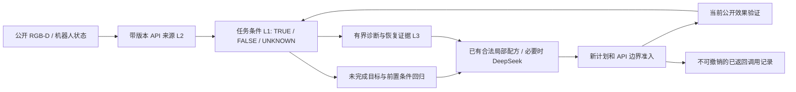

# CaP-X Graph V22 开发验收（2026-11-22）

## 判断与范围

已在正式项目 `/home/hanyu/dqb/cap-x-20261106` 增量实现条件图、条件回归恢复、执行许可和有界诊断；不是新增 Agent 框架。分支 `feature/graph-complete-20261120`，起始 HEAD `5c4f1c7f30549d533541a14cb18af6274afdac5c`；修改尚未提交。本轮开始时工作树干净，无需停止旧冻结批次。

已证明图能改变局部恢复决策和实际运动调用；尚不能证明总体任务成功率提升。真实 Restack 暴露并修复了新条件计算错误，原失败全部保留。允许继续固定、小规模开发验证；360/1800 episode 或正式效果声明仍为 **NO-GO**。

产物根目录 [graph_v22_20261122_180352](/home/hanyu/dqb/cap-x-20261106/outputs/model_comparison/graph_v22_20261122_180352)（下文 R）。V21.3 基线、V22.0 初步回放、V22.1 完整小规模在线、V22.2 修订验收各自独立，不能合并为成功率样本。每对 G0/G1 共享 Snapshot、初始程序、任务 Prompt/API 文档；恢复代码根据各自反馈生成。

## 修改与执行语义

| 模块 | 改动 |
|---|---|
| `capx/execution/task_conditions.py`（新增） | 在原 DependencyGraph 中保存 TRUE/FALSE/UNKNOWN、任务子目标、契约、预期效果、公开证据和 epoch。Stack/Lift/Restack 条件回归；实际调用目标与最终任务目标分开。 |
| `capx/execution/graph_executive.py`（新增） | 确定性调度器，从未满足目标回归必要前置条件，结合当前抓持/释放约束选择已有配方。 |
| `capx/execution/dependency_graph.py` | 区分历史 attestation 与失效传播边；限制诊断所有列表及节点负载，优先保留根因与失败检查。 |
| `capx/execution/grounded_feedback.py` | 将公开观测、技能返回、物理检查接入条件图；计划/在途边界/最终释放检查条件；增加 `verify_task`；完整任务候选与独立 reward 分离。 |
| `capx/execution/grounded_recovery.py` | 增加仅释放撤退、仅补证、剩余任务获取、已接近后续抓取等配方；实际使用来源和新计划返回单独记账。新 source ID 不算物理进展。 |
| `capx/execution/diagnostic_context.py`（新增）、`capx/experiments/graph_feedback.py` | 有界图摘要、历史代码和恢复 Prompt；完整父进程图不裁剪。 |
| `capx/experiments/graph_v2.py` | `budgets.task_conditions` 开关；原 Runner、父进程 broker、Sandbox、Provider、Snapshot、预算与评分保持原入口。 |
| `scripts/local/replay_graph_initial.py` | 明示历史契约迁移及一次释放前软件暂停；始终零新 LLM，不能混作新模型试验。 |
| `env_configs/graph_feedback/development-v22.json` | 新开发配置；未启用条件图时保留旧路径。 |
| 三个 `tests/graph_v2/test_*v22.py` | 30 项增量机制回归。README、V2/V22 指南和本报告更新。 |

技能契约复用既有数值/阶段验证器，当前并非通用 PDDL 规划器。图决定恢复目标、依赖失效和可复用范围；配方决定合法动作次序，不把 DAG 拓扑顺序当动作序列。已返回调用永久保留，新恢复使用新计划 ID。动作返回不建立物理效果；释放返回不能证明已脱离；Restack 绿色桌面放置不能被当作整项任务完成。

持续持物依据公开抬升/共动验证，并受当前夹爪和附着一致性约束；历史证明不是新位置的许可。未确认物理效果继续隔离。只支持技能/API 边界干预，没有运动中取消能力。

## 关键机制证据

| 案例 | 验证范围及结果 |
|---|---|
| A 支撑更新 | 真实 Monitor＋Mock 公开来源更新使旧放置计划失效，持物仍为 TRUE；选择重新定位/放置，不重复 close/lift。最终 capture 后旧释放许可失效时两组均不派发 open。属于软件边界证据。 |
| B 完成效果被破坏 | Mock 公开几何改变使绿色桌面条件 FALSE，已完成调用保持 done；条件回归指向受损绿色阶段。手持红块时不自动重放绿色操作，交给新规划。尚无真实外部物理扰动效果验证。 |
| C Restack 跨阶段 | Mock 机制选择红块剩余任务，不重抓绿色；V22.1 真实 G1 的 block 9 完成绿色放置和撤退，block 10 由图选择 acquire_remaining，实际抓取红块。最终任务未成功。 |
| D 抓持证据不足 | V22.1 新 DeepSeek Lift 两组都自动调用 verify_hold，实际物理评分成功；没有重复关闭夹爪或再次盲目抬升，没有 LLM 重规划。这是共同底座收益。 |
| E 无法安全恢复 | 未知物理效果 Mock 保持隔离；真实 Restack 在证据无法获得后受控退出、reward=0。局部配方连续两次无进展停止自动配方，后续 LLM 仍受 episode 总预算约束。 |

最清楚的图决策差异来自历史 Stack 程序＋实时视觉＋一次软件边界暂停：放置已返回、释放未执行，G1 保留持物及当前对齐证据，选择 `release_retreat`；最终释放依然重新验证，再建立新的撤退计划。G0 选择新的 `replace_placement` 保守配方。两组都物理成功，未重复派发同一个旧调用 ID。

V22.1 此案例 G0/G1 实际底层调用 20/14，其中 goto_pose 为 15/9；RGB-D capture 94/65，执行墙钟 38.46/31.77 秒。G1 少 6 次运动、29 次观测，约省 6.70 秒。公共观测耗时 9.71/6.58 秒，控制 18.82/16.56 秒，监控 4.13/2.90 秒。不是用保留节点数估算收益，也不是自然物理故障或新初始模型成功。优化后的非图状态机也可能实现同一规则，当前证据不证明图表示具有不可替代性。

## V22.1 真实 DeepSeek + Vision（修订前，完整保留）

模型 `deepseek-v4-pro`，reasoning low，max_tokens 32768；实际 SAM3、GraspNet、RGB-D、PyRoKi，无 Oracle 替代程序。每任务一个固定开发场景、一次共享初始生成，不估算总体成功率或置信区间。

| 任务 / Seed | G0 / G1 物理得分 | 底层 API | 观测 | LLM 重规划 | 计入共享初始的端到端秒 |
|---|---|---|---|---|---|
| Stack / 1257104511 | 1 / 1 | 12 / 12 | 59 / 59 | 0 / 0 | 63.5 / 60.7 |
| Lift / 789990565 | 1 / 1 | 8 / 8 | 35 / 35 | 0 / 0 | 47.4 / 44.9 |
| Restack / 1482414119 | 0 / 0 | 25 / 38 | 192 / 286 | 6 / 10 | 450.5 / 855.7 |

G0/G1 均 2 个成功、1 个失败，配对胜/负为 0/0；不能由此推出等效。Stack/Lift 没有图的调用优势；Restack G1 推进更远但耗时和调用更多，两组最后均 `held_surface_evidence_unrecoverable`。恢复生成的随机性没有被消除，单个跨阶段案例不能单独归因于图。

唯一计费请求 19 次，全部 HTTP 200、finish_reason=stop、模型名一致、单次尝试；最高 completion 8,142，未发生 32,768 上限截断。输入 187,586、输出 90,824，其中 reasoning 83,832 已包含在输出内。现有保守账本 $0.607277；按仓库已记录价表考虑缓存的峰值估算 $0.529859，非服务商账单。共享初始仅计费一次；每组比较端到端时间均包含同一初始生成时长，不能拿 G1 缓存命中后的本地墙钟直接减 G0。

### 在线发现与 V22.2 修复

G0 绿块移到画面右缘，table_place 返回后当前表面不可验证；未派发 open_gripper。G1 成功完成绿色阶段并抓红块后，新的绿色桌面条件错误变为 FALSE。离线物理诊断显示 block 10/11 绿块位移均为 0、四个桌面接触仍在；这些真值仅用于本报告，未输入 Agent。

冻结公开 RGB-D 的 frame 249（图节点 n001099）证明：旧代码用原始可见中心构造桌面参考，随后又把物体中心替换成完整竖直面推断，制造 14.575 mm 横向误差；gap=0。V22.2 先选当前物体估计，再建立同一水平桌面的参考，得到 xy=0、gap=0。正向和抬高反例测试均通过，几何阈值、放置前空间清障、最终释放准入和独立成功评分均未修改。条件指标现随图归档。

同时修复历史目标来源：table_place 实际目标记为 table，place 绑定 plan 的 support source，release/retreat 继承实际最近定位目标；不再用任务的最终目的地冒充实际调用目的地。

证据：[restack-table-condition-diagnosis.json](/home/hanyu/dqb/cap-x-20261106/outputs/model_comparison/graph_v22_20261122_180352/restack-table-condition-diagnosis.json)、v22-2-public-boundary-red.log、v22-2-frozen-table-condition.json、online-v22-1/normal-restack/episodes/G1/block-11-evaluation.json。V22.2 相比冻结 V22.1 仅改变 `task_conditions.py` 的运行时内容，不回写旧结果。

## 最终回归与修订验收

最终 V22.2 相关完整图测试：**1,141 passed / 6 skipped / 0 failed**；六项真实渲染补验 **6 passed**，合计 **1,147 个不同图测试全通过**。分层反馈 28 passed；本轮 P0（含 Provider Mock）68 passed，其中 Sandbox 17、Reward 13、Provider Mock 8，实际视觉两项也通过。P0 在末次仅 TaskConditions 修订之前运行，受保护 P0 源码保持相同哈希。V22 新增机制测试 30 passed。

JUnit/完整日志分别保存在 [v22-2-all-graph-host.xml](/home/hanyu/dqb/cap-x-20261106/outputs/model_comparison/graph_v22_20261122_180352/v22-2-all-graph-host.xml)、[v22-2-render.xml](/home/hanyu/dqb/cap-x-20261106/outputs/model_comparison/graph_v22_20261122_180352/v22-2-render.xml)、[v22-2-layered.xml](/home/hanyu/dqb/cap-x-20261106/outputs/model_comparison/graph_v22_20261122_180352/v22-2-layered.xml)、[p0.xml](/home/hanyu/dqb/cap-x-20261106/outputs/model_comparison/graph_v22_20261122_180352/p0.xml) 及同名 .log。完整图的首次受限环境运行出现 1 个旧导入测试失败：全局 subprocess Mock 遇 Matplotlib 冷缓存字体查询返回错误类型；未修改测试/依赖，在已有主机环境完整补验通过。原记录 [v22-2-all-graph.log](/home/hanyu/dqb/cap-x-20261106/outputs/model_comparison/graph_v22_20261122_180352/v22-2-all-graph.log) 保留。开发期曾由完整回归发现诊断裁剪遗漏 lift UNCERTAIN，已修复为优先根因/失败检查，[all-graph.log](/home/hanyu/dqb/cap-x-20261106/outputs/model_comparison/graph_v22_20261122_180352/all-graph.log) 保留该失败。

有界诊断用 50/500/5,000 节点测试，输出约 1,446/1,448/1,450 字符（V21 原为 1,753/11,653/110,653）；完整图均保留。V22.1 实际 Restack 恢复动态上下文最大 G0 24,516、G1 22,998 字符，固定任务和 API 文档另计。关键当前条件、终止原因保留在摘要之外的固定小集合中；裁剪不参与执行准入。

最终 V22.2 三对历史程序＋实时 Vision 重放，**新 LLM 请求 0、费用 0**：

| 历史程序诊断 / Seed | G0 / G1 得分 | 底层 API | 观测 | 本次执行秒 |
|---|---|---|---|---|
| normal-lift / 1003909883 | 1 / 1 | 5 / 5 | 19 / 19 | 17.15 / 17.08 |
| normal-restack / 677061216 | 0 / 0 | 10 / 10 | 62 / 62 | 30.03 / 30.12 |
| stack-release-pause / 953265258 | 1 / 1 | 20 / 14 | 94 / 65 | 39.40 / 32.11 |

Restack 的 budget_exceeded 在这个专用入口表示 NoModel 拒绝调用新的 LLM，并非真实付费额度耗尽；先完成两次无进展局部尝试后有界退出。Lift 是无需恢复的正常完成证据；Stack 暂停是软件机制测试。全部 Snapshot/代码/Prompt/API 文档配对 hash 一致，374 个运行时文件 postcheck 通过。明细见 [v22-2-replay-analysis.json](/home/hanyu/dqb/cap-x-20261106/outputs/model_comparison/graph_v22_20261122_180352/v22-2-replay-analysis.json)，原视频/trace 在 [replay-v22-2](/home/hanyu/dqb/cap-x-20261106/outputs/model_comparison/graph_v22_20261122_180352/replay-v22-2)。

修订后仅增加一对同 Seed 的新 DeepSeek Restack 回归，不反复采样筛成功：

| 组别 | 得分 / 状态 | 底层 API / 观测 | LLM 重规划 | 端到端秒 |
|---|---|---|---|---|
| G0 | 0 / budget_exceeded | 37 / 282 | 12 | 945.9 |
| G1 | 0 / interrupted | 42 / 313 | 10 | 749.3 |

G0 在绿色阶段耗尽局部恢复预算（local_recovery_budget_exhausted）；G1 绿色放置/撤退后，图选择 acquire_remaining，实际完成 6 次底层调用并建立红块持物；随后放置恢复实际复用支撑来源 n000927，但当前红块表面无法可靠验证，最终耗尽代码块预算（episode_code_block_budget）。G1 此次有 11 次绿色桌面 TRUE 条件记录、没有该条件的 FALSE 转换；这不是 11 个独立样本。

G1 最后释放检查的离线物理代理：横向偏差 1.88 mm、底部间隙 4.57 mm、仍有双侧抓持；在线因缺少当前表面/刚体高度证据而 UNCERTAIN，故未释放。末帧可见夹爪遮挡红块：[diagnostic-frames/v22-2-restack-G1-last.png](/home/hanyu/dqb/cap-x-20261106/outputs/model_comparison/graph_v22_20261122_180352/diagnostic-frames/v22-2-restack-G1-last.png)。不能根据离线真值替在线系统直接放行。

两组均未完成任务。G1 少 2 次 LLM 重规划、端到端约少 196.6 秒，但多 5 次底层 API 和 31 次观测；LLM 耗时为 834.2/624.9 秒，控制为 30.2/42.1 秒，监控为 37.8/33.7 秒。组件内感知服务计时有嵌套，不能机械相加。该单场景差异包含恢复生成随机性，不能声称图普遍节省时间或提高成功率。

已有独立分析器对可标注检查给出的计数（重复检查，不是独立事故/场景；新条件图检查尚未全部覆盖）：

| 组别 | true_allow | true_block | false_block | false_allow | unknown |
|---|---:|---:|---:|---:|---:|
| G0 | 43 | 12 | 10 | 4 | 4 |
| G1 | 57 | 9 | 14 | 4 | 1 |

false_allow 均来自桌面边界 footprint 代理：每组 2 个候选、各重复检查 2 次，足迹边缘约 4–5 mm 超出真值桌边；不是 4 次已证实的碰撞/跌落，也不是最终释放许可。已有分析器采用保守几何代理；false_block 可以是在线缺证造成的合理拒绝。G1 的 9 条释放 false_block 不能简单改成放行规则。下一步需用公开边界证据核对完整候选足迹、可达性及持物视野，保留这些风险记录。

明细见 [v22-2-online-analysis.json](/home/hanyu/dqb/cap-x-20261106/outputs/model_comparison/graph_v22_20261122_180352/v22-2-online-analysis.json)、[v22-2-restack-stage-accounting.json](/home/hanyu/dqb/cap-x-20261106/outputs/model_comparison/graph_v22_20261122_180352/v22-2-restack-stage-accounting.json) 和 [online-v22-2/normal-restack](/home/hanyu/dqb/cap-x-20261106/outputs/model_comparison/graph_v22_20261122_180352/online-v22-2/normal-restack)。V22.1/V22.2 使用相同固定 Seed，但重新生成了初始程序，不能把跨版本差异当成只改变一行逻辑的因果实验；二者内部 G0/G1 初始 hash 各自一致。未再追加试跑。

## 成本、边界和下一步

本轮新 DeepSeek 调用总计 **42 次**（V22.1 19，V22.2 23），没有自动 HTTP 重试，均 HTTP 200 / stop，模型名匹配；没有未知用量请求。输入 **433,134**、输出 **199,994**，其中 reasoning **184,821** 已包含在输出中。现有保守账本合计 **$1.363713**；仓库已记录缓存价表的峰值估算 **$1.175723**，非当前报价核验或最终账单。API 请求墙钟累计 2529.2 秒，不与并列/嵌套计时重复相加。逐请求账见 [api-accounting-final.json](/home/hanyu/dqb/cap-x-20261106/outputs/model_comparison/graph_v22_20261122_180352/api-accounting-final.json)。

最终 374 文件运行时 hash 校验通过；物理评分/Sandbox/Actor 等 7 个受保护文件与 V21 基线相同。密钥文件保留、0600、Git 忽略；新增文本按实际加载的密钥值扫描未发现泄漏。SAM3、带 Seed Schema 的 GraspNet、PyRoKi OpenAPI 均返回 200；没有本轮图试验遗留进程，没有重启其他项目服务。NVML 仍报 driver/library mismatch（580.178），无法可靠报告显存；沿用现有软件 EGL/CPU IK，不升级驱动或依赖。见 [postflight.json](/home/hanyu/dqb/cap-x-20261106/outputs/model_comparison/graph_v22_20261122_180352/postflight.json)、[integrity-final.json](/home/hanyu/dqb/cap-x-20261106/outputs/model_comparison/graph_v22_20261122_180352/integrity-final.json)。

**GO：实现与固定小规模开发诊断可复跑；NO-GO：扩大成多任务可靠性结论、360/1800 正式批次。** Stack/Lift 有新 DeepSeek 物理成功和回归证据；Restack 有真实跨阶段续接，完整闭环成功尚未获得。B0 原接口和原评分保留，本轮未新跑 B0，不能外推 G1 对 B0 的效果。

配置每 pair 最多 32 请求、账本上限 $5、4 小时；每 episode 16 blocks、192 底层 API、2,400 秒；局部修正 24、视角 8、恢复配方 6、连续无进展 2。每个独立命令有独立账本，不能据此无上限启动多个命令。没有新 360/1800 批次、下载模型、训练或真实机器人操作。

在线观测仍有同相机系统偏差；表面几何 TRUE 不是触觉或物理成功证明。图只能调度现有公开感知和合法技能，不能凭条件推理补出不可见信息。已释放再撤退、抓持丢失后重建场景、任意临时放置的恢复覆盖仍有限；跨阶段已有实际进展，完整 Restack 的稳健效果仍需额外固定场景验证。下一步优先验证当前单面估计、桌面可见区域与附着视野之间的协同，以及多次 LLM 无进展时更早判定不可恢复；不通过放宽准入刷成功。

复跑命令及开关见 `docs/feedback/graph-v22.md`。所有新图、trace、视频、请求与单样本结果在 R，各实验目录含 source archive 和 postcheck；完整图未被摘要裁剪。Runtime manifest 固定的是本轮开发版本，不是正式测试冻结。
