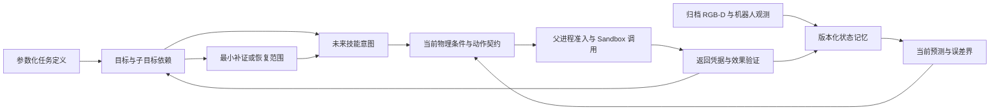

# CaP-X Graph V23 开发报告（2026-11-22）

## 结论与验收边界

已实现并运行通用目标/技能意图与有界状态记忆原型。**核心总验收尚未通过：没有取得 Restack 完整成功，也没有取得真实遮挡下预测证据批准最终释放的物理成功案例。** 不启动正式规模实验；本轮依照“先零新增 LLM 验收”的顺序，未发起新的 DeepSeek 请求。

正式目录 `/home/hanyu/dqb/cap-x-20261106`，分支 `feature/graph-complete-20261120`，开始 HEAD `73be0eb6cb5e0756265254ad155f9d022e4e7e75`，开始工作区干净。新增修改尚未提交/推送。原 V22.2 和历史产物保留。本轮目录：

`outputs/model_comparison/graph_v23_20261122_214021`

## 实现与通用性审计

- `task_definition.py` 集中保存基准目标与公开对象绑定；通用执行器不再根据 Stack/Lift/Restack、颜色、固定对象或故障类型选择恢复动作。`task_conditions.py` 删除 `STAGES` 与任务专用 `goal_keys`，解析结构化对象、目标和依赖。
- `graph_executive.py` 回归当前未满足目标，分别选择补证、修复、续接或不能安全恢复。已经定位但对齐证据 UNKNOWN 时选择 `verify_placement`，避免直接重复整段放置。明确 FALSE 与 UNKNOWN 不再共用一个恢复分支。
- `grounded_recovery.py` 继续生成原 Sandbox 可执行的合法技能调用；对象与支撑由绑定与条件决定。G0 保留强保守后缀策略、原恢复能力和完整预算；G1 选择相关证据和意图。没有添加任务专用恢复配方。
- 父进程在第一段 Python 执行前建立未来目标和 `skill_intent`，通过技能契约展开合法技能意图，登记顺序约束。`declare_intent` 接受模型的独立声明，但不能改目标、注入数值目标或授予权限。实际 plan、夹爪调用和返回凭据关联意图。返回凭据不等于物理效果，已完成调用不能重放。
- 图决定失效、诊断根、目标回归、可保留证据和下一项工作。技能配方决定合法物理操作次序；没有把拓扑排序当作机器人动作顺序。

自动 AST 审计在 `graph_executive.py / grounded_recovery.py / task_conditions.py` 的条件分支中没有发现任务/故障属性或固定任务/颜色值分派，结果见 `core-audit.json`。对象改名、角色交换、子目标声明顺序交换、依赖回归和错误声明拒绝均有确定性测试。这是代码与软件机制证据，**不是任意新任务已经获得物理验收**。当前仍限于原 Panda、直立刚性方块、既有颜色感知适配；同色实例、新形状、多个同时抓持目标及同一对象的多个歧义目标不宣称支持。

## 状态记忆与准入

新增 `state_memory.py`，复用已有完整面估计器、TCP 刚体变换、公开机器人状态和 NPZ 文件。图存对象身份、几何、来源引用、相机标定、物体—TCP 关系、grasp epoch、运动路径与状态；不将点云塞进提示词。

当前直接观测、由历史传播的 PREDICTED、CONTRADICTED 和 UNKNOWN 分开记录。只有可定位完整面的观测才能初始化预测锚点；原宽松 top/颜色质心和刚体预测本身不能成为独立新锚点。运动距离、旋转、时间都增加界限，同一遮挡视角、新来源 ID 或新 LLM 调用不算进展。

预测要求：同一有效相机/坐标契约、当前抓持已验证、未空爪、grasp epoch 一致、直立与运动界限满足；当前深度还须证明几何视线被遮挡。空深度和视野外属于意外缺失。静态支撑要有积极的非接触几何证据；可能接触立即撤销，随后抬升不能复活旧证据。明确矛盾、滑移、抓持丢失、标定变化和未知动作效果会失效，部分可见像素只可反驳模型，不能据“未反驳”证明没有移动。

保留 `check_surface()` 和原直接观测路径；没有修改 `allow_retained=False` 的含义。预测路径的最终下降与释放均检查完整误差区间。原释放阈值不变：XY ≤ 8 mm，间隙 [-4, 16] mm。许可在最后一次 capture 后再检查。测试证明：同一预测先通过，最后 capture 出现滑移/失效时，G0/G1 都不派发 open_gripper。

标定来自三个历史开发 episode，复用独立离线真值，仅输出无位姿、无偏移补偿的标量误差界和来源 hash。旧宽松路径最大 XY 误差约 12.82 mm，不能作为可信锚点。完整面路径 316 个去重标定观察的最大误差加 1 mm 余量得到：XY 2.9066 mm、顶面 Z 2.5706 mm、尺寸 2.8751 mm。运动/时间增长量另计。

这只是**有适用条件的开发经验包络**，不是独立统计保证：增长率是公开的保守工程模型，尚无覆盖任意滑移/外力的标定。当前没有可靠触觉输入；未知外力不能因“未检测到接触”被视为不存在。此限制是后续扩大前的阻塞之一。

## 冻结感知重放：此前最后释放为何仍被拒绝

工具：`scripts/local/replay_state_memory.py`；最终产物 `frozen-restack-memory-final/`。它仅回放归档公开传感器/父进程阶段，物理真值只在预测完成之后用于离线误差检查，不执行机器人动作或模型调用。

历史 Restack G1 中 17 次遮挡检查：8 次得到预测，9 次保持 UNKNOWN（主要为 10 秒有效期耗尽）。8 次预测的已对齐离线 XY/Z 误差都在本版界内。其间 1 次属于桌面或未定位阶段，不套用堆叠释放评分；7 次红块放置检查全部因区间不足保持 UNCERTAIN。

例：frame 00300 的预测 XY 上界约 9.11 mm、间隙区间约 [-5.31, 15.63] mm，超出 8 mm 和 -4 mm 下界；frame 00303 仍不满足。frame 00253 的区间更宽。此时“名义几何看起来合适”不足以授权释放。没有缩小包络来让这些样本通过。这些数字是冻结感知离线结果，不能冒充真实在线完成。

## 实时 Vision、零新增 LLM 的配对结果

每对共享原 Snapshot、历史真实 DeepSeek 初始程序、任务、文档和预算，四种 hash 核验见 `pair-integrity.json`。所有组仍使用实际 SAM3、GraspNet、仿真和原独立评分。以下为各自开发修订的结果，**不混为一个冻结版本的成功率统计**：

| 场景/产物 | G0 / G1 物理 reward | 实际 API G0 / G1 | capture G0 / G1 | 本次实测秒 G0 / G1 |
|---|---|---|---|---|
| Stack 1257104511，replay-stack-1 | 1 / 1 | 12 / 12 | 59 / 59 | 33.07 / 33.01 |
| Restack 1482414119，replay-restack-2 | 0 / 0 | 10 / 9 | 63 / 57 | 35.82 / 33.07 |
| Stack 953265258，final-stack-pause | 1 / 1 | 20 / 14 | 94 / 65 | 51.70 / 40.51 |
| Stack 2062029304，final-stack-occlusion | 0 / 0 | 12 / 12 | 58 / 58 | 29.28 / 29.45 |
| Lift 789990565，final-lift | 1 / 1 | 8 / 8 | 35 / 35 | 22.40 / 22.65 |

说明：

- `final-stack-pause` 是明确声明的软件边界中断，没有移动真实物体或伪造感知。G1 选择已有定位后的 release/retreat，G0 再做保守 place；相同成功子目标下，G1 实际少 6 次控制调用、29 次 capture，约少 11.20 秒。观察/控制/监控分别约 13.86/17.19/3.26 秒，对应 G0 20.49/19.98/5.11 秒。该证据支持选择性续接有收益，不证明图表示不可由其他方法实现，也不是遮挡恢复成功证据。
- Restack 仍在绿块桌面目标/可见清障阶段受阻，未到最终红块释放。两次已知局部恢复未取得进展，零 LLM 重放器拒绝新模型请求后退出。其 `budget_exceeded` 是诊断入口 NoModel 预算，**不是 DeepSeek 余额不足**。G1 提前少一次调用不能作为任务效率提升。
- 历史遮挡 Stack 2062029304，两组仍因 `held_surface_evidence_unrecoverable` 安全退出，完整任务失败全部保留。
- 正常 Stack/Lift 与恢复暂停有真实物理成功；对象换名/角色交换与预期遮挡许可的正例仍主要是软件机制测试。
- `replay-restack-1` 的两个早期失败额外保留；其中 G1 预测来源进入桌面检查时发现变量引用错误，先补失败测试，再修复并执行 `replay-restack-2`。没有用改测试掩盖运行错误。
- 最后一次在线 replay 后仅修正摘要中 DIRECT 的来源标记；再运行 V23 针对性测试。各运行保存自己的源字节和 postcheck，不把旧版本实验称为最终冻结评测。

重放继承的 result 包含历史初始生成耗时；表中用 `total_seconds` 报告这次实际墙钟，不把旧 initial latency 再算成真实在线等待。汇总 `experiment-accounting.json` 已剔除历史 LLM 时间/成本。**本轮新增 DeepSeek/OpenAI 请求 0、Token 0、付费模型成本 0**。没有启动 360/1800 episode 批次。

## 测试与安全回归

- Graph 主回归：`final-all.xml`，1173 passed / 6 skipped / 0 failed。
- 六项真实渲染补验：`render.xml`，6 passed，真实配置和 Snapshot、零机器人 API。
- 最终 V23 机制：`v23-final.xml`，34 passed。包括额外的可能接触失效、对象角色重组、声明顺序不等于动作顺序、旧许可阻断与不可信声明拒绝（无进展恢复另由完整共享回归覆盖）。
- 释放/在途依赖/记忆专项：`final-memory.xml`，45 passed；与上述重复的用例不重复计数。
- 去重后 Graph 覆盖合计 **1181 个通过用例**（以 JUnit classname/name 合并，不是一次命令的统计）。新增末尾机制用例有独立最终记录。
- 原分层反馈：28 passed；P0/Provider：68 passed、0 skipped，含真实 Seed 服务与 Oracle 物理记账。
- 最初红测试、阶段性失败日志均保留。回归修复了 legacy finish adapter、配置标定文件放置位置、桌面预测来源引用；受限环境的既有字体缓存/import-order 失败在原主机依赖中复核，不修改依赖。

`physical_evaluation.py`、audited Stack、任务评分适配、Sandbox、actor 和原 Robosuite Stack/Lift 七个受保护源文件与本轮开始归档一致。没有训练、模型下载、依赖升级、真实机器人操作或服务重启。NVML 驱动/库不匹配仍存在；继续使用原 Mesa 渲染和 CPU IK，未宣称 GPU 正常。三个现有服务在线，不停止其他项目进程。

## 剩余问题与下一步

1. **Restack 完整闭环 NO-GO。** 桌面候选的清障/可达性和最终遮挡证据界限仍阻塞，没有真实完整成功。
2. **预测释放的在线正例 NO-GO。** 不能用 Mock 的 PASS 或 8 个冻结预测误差在界内替代实际物理释放成功。需要改进可识别几何/相对位姿标定或合法主动补证，使区间自然落入原契约；不能降低阈值。
3. **误差模型泛化 NO-GO。** 当前开发经验包络尚无充分独立动态扰动标定；隐蔽滑移和外力需要更强传感或更明确的可验证运动假设。
4. 通用目标回归、未来意图、状态记忆生命周期、旧许可拒绝、有限补证退出：软件机制 GO；当前已验收正常任务与选择性续接可以继续小规模开发回归。
5. **新的付费 G0/G1 配对及扩大开发集暂不启动。** 用户要求先通过零新增 LLM 验收，本轮关键目标仍未通过，保留配置与命令等待上述缺口闭合。不能给出 G1 相对 G0 的总体成功率提升结论。

运行命令、结构化定义、开关和限制见 [V23 使用说明](../feedback/graph-v23.md)。
