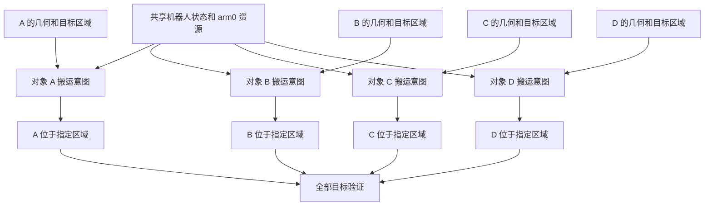

# Graph V24 开发验收：通用契约、原生长程任务与能力缺口

日期：2026-11-23。正式工程 `/home/hanyu/dqb/cap-x-20261106`，分支 `feature/graph-complete-20261120`，HEAD `73be0eb6cb5e0756265254ad155f9d022e4e7e75`。本轮改动尚未提交；原有 V23/V23.1 未提交工作保留。

**结论：完成了通用契约执行原型、真实连续四物体搬运参考实验和单螺母参考实验；尚未完成新增任务的 Vision 物理闭环，因此 V24 核心完整验收和新的模型配对均为 NO-GO。** 不能把 Oracle 成功、工具响应或 1,334 项测试通过称为 Vision Agent 成功。本轮没有调用 DeepSeek，没有训练或下载模型。

所有开发成功与失败在同一个新目录中保留：

`outputs/model_comparison/graph_v24_20261123_155255/`

以下称为 R24。最终源码对应的记录使用 `release-*`；较早的调试结果不能混入最终成功率。机器可读汇总为 [release-audit.json](../../outputs/model_comparison/graph_v24_20261123_155255/release-audit.json)，命令见 [V24 使用说明](../feedback/graph-v24.md)。

## 1. 通用性落实到哪里

采用同一套 `ContractGraph → GraphExecutive.next_contract → ContractBroker`，输入是对象绑定、目标条件、技能意图、前置条件、预期效果、顺序约束和资源占用。图核心不根据任务名、颜色、具体对象、Seed 或故障标签分派动作。不同环境共用一个原生 Robosuite 边界；环境声明和原生评分不放进通用推理核心。

新增能力包括：

- 执行前登记未来技能和依赖；共享机器人资源互斥；验证器缺少证据时保持 UNKNOWN。
- 动作许可绑定当前条件版本。最终补证先完成，再取得许可；旧许可失效后不能派发动作。
- 已完成调用是不可重放的历史记录；已完成效果可被新反证撤销。汇合目标通过显式 `effect_dependencies` 随子目标失效。
- 已有可信效果可满足明确允许的条件依赖，不伪造一次已完成调用；要求真实先后调用的顺序仍严格执行。
- 局部反证回归到相应目标，生成新的修复 intent ID，保留有效兄弟目标；相同真值状态和仅增加来源 ID 不能无限生成修复。
- 一个分支不能取得信息时，可以为其他独立分支补证；无进展或无合格能力时有界退出。物理效果未知继续隔离。

能力边界仍然存在：图可以组织任意**已声明且有合格技能/验证器支撑**的任务，不能自动发明缺失的物理技能。新容器放置、精细插入和双臂接收验证需要共享能力实现及实测，不能把方块堆叠的感知误差包络和释放契约直接套上去。

原有 `GraphExecutive.decide` 字节保持不变。旧 Stack/Lift/Restack 仍走原监控执行路径；新的契约入口已经参与本轮调度和真实 Oracle 执行，但**尚未将所有旧入口统一迁入它**。本轮不能宣称已经完成全项目单一执行路径的迁移。

### 真实多目标依赖

四物体 PickPlace 是一次连续物理 episode，没有中途 reset、设置物体状态或拼接 episode：

当前声明是 4 个独立搬运意图 + 1 个汇合验证，技能深度 2、宽度 4、1 个汇合、1 个共享前置条件。技能顺序边没有分叉，分叉来自共享条件；arm0 将真实动作串行化。单螺母是 1+1 技能，双螺母是 2+1 技能。没有把不同 Seed 或单/双螺母配置虚增为新任务类别。

这仍不是深层、多级分叉装配基准。物理完成效果被后续扰动破坏后的选择性修复，本轮完成了确定性契约测试，尚未完成真实 Vision 受控故障实验。

## 2. 逐任务 Gate 状态

Gate 1 在最终源码下对 7 个配置、6 个任务族、固定 Seed 0/21 全部实测：每个组合两次全新环境重建，模型、完整初始物理状态、控制量、warmstart 和 RNG 一致；初始物理成功均为 false。这里验证的是**初始状态精确重建**，不是任意中途状态恢复。

| 任务 | Gate 1 | Gate 2：实际 Oracle | Gate 3：真实视觉 | Gate 4：图执行 | Gate 5：模型配对 |
|---|---|---|---|---|---|
| 原生 PickPlace，四物体 | 两 Seed 通过 | Seed 0 完整成功；21 为 3/4，IK 阻断 | 3/5 查询对象有唯一可见候选；容器和 Bread 不足 | 契约实际驱动 Oracle；视觉补证后阻断，未闭环 | 未运行 |
| NutAssembly 单螺母 | 两 Seed 通过 | 0/21 均完整成功 | 本次整体、把手及柱体查询未建立唯一可靠绑定 | 图声明/补证可运行；插入 Vision 技能未验收 | 未运行 |
| NutAssembly 双螺母 | 两 Seed 通过 | 0/21 都只完成方螺母 | 只有部分柱体候选；孔/柄相对姿态不足 | 独立目标和汇合机制测试通过；真实图装配未通过 | 未运行 |
| TwoArmHandover | 两 Seed 通过 | 旧 Privileged Oracle 在 Seed 0 重新实测成功 | 未通过双臂公开感知与稳定接收验证 | 双资源/禁止过早释放为机制测试；无新物理图闭环 | 未运行 |
| Door，带门闩 | 两 Seed 通过 | 未运行新 Oracle | 实际 SAM3 查询低置信度，未绑定把手 | 缺关节进度、接触操作和安全 Skill | 未运行 |
| TwoArmPegInHole | 两 Seed 通过 | 未运行新 Oracle | 未验收 | 缺合格双臂协调与接触/插入进度能力 | 未运行 |
| ToolHang | 两 Seed 通过 | 未运行新 Oracle | 未验收 | 缺对应精细操作与验证能力 | 未运行 |

环境证据：`R24/release-environments-{0,21}/`。旧多任务 Oracle 的真实重跑结果在 `R24/legacy-oracle/{nut_assembly,handover}/acceptance.json`，同时通过原有 pass、空程序、语法错误、隐藏状态、FINISH、超时检查和 Snapshot 重放。这不是新增 Vision 成功证据。

原生评分继续调用各环境原有 `_check_success()`；每物体进展读取原生 `objects_in_bins` / `objects_on_pegs`，未套用 Stack 的评分。该状态仅进入独立评估和显式 Privileged Oracle。Vision actor 无 Oracle API，也不能借裸 `goto_pose`、`open_gripper` 绕过未验收的技能许可。

## 3. 最终固定场景物理结果

### PickPlace 契约参考配对

这张表是**Privileged Oracle + 新契约原型**的 G0/G1 证据范围策略配对，不能当成原有强 G0/G1 的 DeepSeek + Vision 效果实验。原有强 G0 没有修改或削弱，B0 未运行。

| Seed | 策略 | 原生完整成功 | 完成对象 | 真实 RPC | 其中控制调用 | 逻辑条件检查项 | 整个 Gate 墙钟秒 |
|---:|---|---|---:|---:|---:|---:|---:|
| 0 | G0 保守补证 | 是 | 4/4 | 48 | 36 | 42 | 29.742 |
| 0 | G1 选择性补证 | 是 | 4/4 | 48 | 36 | 38 | 30.172 |
| 21 | G0 保守补证 | 否 | 3/4 | 45 | 33 | 36 | 27.142 |
| 21 | G1 选择性补证 | 否 | 3/4 | 45 | 33 | 32 | 28.470 |

每对初始 Snapshot 完全相同，程序与源码相同；各次结束的源码复核均无变化。Seed 0 为 5 次高层技能调用（包括最终验证）；Seed 21 为 4 次尝试、3 个已完成意图。两组 Seed 21 都保留前三个完成效果，没有重做它们。

真实 IK HTTP 次数分别为 Seed 0 每组 36、Seed 21 每组 54。条件检查数量少 4 项不等于少 4 次感知请求：本参考策略使用私有原生状态检验，G0/G1 实际控制、IK 请求均相同。因此**未观察到图带来的任务成功或真实 API 节省**；秒级时间差也不能据此推断效率提升。

在相同任务进展下，Seed 0 是每完成对象 12 RPC / 9 控制调用。Seed 21 的总成本还包括第四次失败尝试，不能把 45 次直接除以 3 后当作已完成目标的技能效率；逐技能记录在 trace 中。两固定开发场景不支持统计显著性结论。

证据：`R24/release-reference-{0,21}-{G0,G1}/pick_place/` 的 `reference-result.json`、`reference-graph.json`、`trace.jsonl`、视频和初始 Snapshot。

### 插入参考策略

| 配置 | Seed | 原生完整成功 | 原生装配进展 | RPC | 整个 Gate 墙钟秒 |
|---|---:|---|---|---:|---:|
| 单螺母 | 0 | 是 | 方螺母完成 | 12 | 7.981 |
| 单螺母 | 21 | 是 | 方螺母完成 | 12 | 6.701 |
| 双螺母 | 0 | 否 | `[1,0]` | 23 | 13.332 |
| 双螺母 | 21 | 否 | `[1,0]` | 23 | 12.442 |

单/双配置使用相同参数化插入参考程序，在每个技能边界读取当前参考特征。该程序是可行性参考，未接入可信公开抓持验证，不能直接登记为在线插入能力。

证据：`R24/release-insertion-{0,21}/{nut_single,nut_dual}/result.json` 和完整动作 trace。

## 4. 根因、修复和保留的失败

1. 初版参考程序使用 Sandbox 不支持的 `np.arctan2`，在执行前被拒绝。修改了参考程序的合法参数使用，没有放宽 Sandbox。
2. 最初总是瞄准容器中心，远侧目标存在 IK 问题。参考放置改为参数化容器区域中的内点，并使用自由偏航的向下放置；不根据对象名或 Seed 选择补偿。原生任务本来允许区域内放置，评分不变。
3. 高物体的模型原点不等于碰撞几何中心，居中抓取还会造成掌部推碰。参考几何改为实际形状中心、窄边夹取和通用顶部抓取带。这是 Oracle 几何/技能可行性修复，**不是**从仿真真值补全在线 Vision。
4. 最终 Seed 21 仍在第四对象的目标求解失败。最后一次 IK 残差约 15.56 mm、2.367°，没有满足原有 1 mm/1° 判据；失败段没有派发。前序物理动作已经发生，因此契约将该复合技能按未知效果隔离，不自动重放。这个保守处理还需要更细粒度的可靠阶段证据才能改进，不能直接绕过。
5. 双螺母的根本失败发生在第二个圆螺母抓持阶段。Seed 0 的圆螺母闭爪后高度约 0.82989 m，抬升命令后约 0.82999 m，没有随末端抬升；方螺母仍保持 `[1,0]` 完成状态。参考程序继续空载执行，最后原生评分失败。已有 trace 证明未稳定持起，**未证明**具体摩擦、夹取轴或接触几何中的哪一项是唯一原因。先前一次性缓存所有目标几何也不合理，已改成逐技能刷新，但失败仍在，不能把缓存问题当作已解决圆螺母失败。
6. 真实视觉不是服务离线：SAM3、GraspNet 和 PyRoKi 均有实际成功响应。PickPlace 的 Milk 仅机器人视角得到唯一候选；Cereal、Can 有可见候选，Bread 和容器仍不足。螺母的“brown square block”会得到两个不同且较高置信候选，不能取最高分冒充实例绑定。轮廓/可见点云也不等于完整形状、孔轴、TCP 附着和安全误差界。

早期失败与修改过程在 `oracle-pickplace-v1` 至 `v6`、`native-insertion-v1/v2`、`vision-probe-v1/v2` 等目录完整保留。它们是开发记录，不作为额外独立样本。

## 5. 真实 Vision 和图补证验收的实际边界

`R24/acceptance-vision/` 对 PickPlace、单/双螺母、Door 执行真实 SAM3 + RGB-D 探测，并对有对象的配置调用实际带 Seed 的 GraspNet。工具 HTTP 次数分别为 18、8、12、4。四物体都有抓取候选返回，但候选不等于可靠抓持成功。

最终 `R24/release-vision-graph/` 让同一通用执行器依次选择独立分支的缺失证据。PickPlace 发出 4 次实际 SAM3 请求，单螺母 1 次，双螺母 2 次，然后停止，没有无信息重试循环，没有释放或其他物理动作。

当前未提供合格的非方块物理技能 registry。即使某个可见性条件为 TRUE，完整几何、目标区域或装配对齐证据仍为 UNKNOWN。`passed:false` 是正确 Gate 结果，不能用已有 Oracle 代替缺失的在线证据。

新契约层尚未接上旧 V23 状态记忆的非方块误差模型；双臂 FK/夹爪/接收关系和资源调度只有环境及机制证据，未形成统一的真实 Vision 控制能力。原有机器人控制器可创建并不证明这些条件已满足。

## 6. 测试与审计

最终测试分进程运行，避免项目原有两个同名 `test_analysis.py` 的 pytest 模块导入冲突。冲突日志 `R24/release-regression.log/xml` 保留；没有修改测试断言让它通过。

| 测试范围 | 通过 | 跳过/失败 | 日志与 JUnit |
|---|---:|---|---|
| `tests/graph_v2 tests/p0 tests/multitask` | 1,131 | 0 / 0 | `release-main.log/xml` |
| `tests/graph_feedback` | 175 | 0 / 0 | `release-graph-feedback.log/xml` |
| `tests/feedback` | 28 | 0 / 0 | `release-feedback.log/xml` |
| 合计（不重复累计旧回归） | **1,334** | **0 / 0** | R24 |

第一行包含 graph_v2 1,052、P0 68、多任务 11 项。V24 新增 27 项已计入其中，不再另加。

机制覆盖多目标独立性、名称/角色替换、依赖循环、资源互斥、接收未稳定时拒绝交出手释放、最后补证撤销许可、效果反证传播、条件性先后关系、旧调用不可重放、新修复 ID、无进展终止，以及真实 Bubblewrap actor 调用契约 broker（该测试的物理部分为 Mock，已明确标记）。视觉候选测试覆盖置信度筛选、重叠候选去重及不同实例歧义。

P0 视觉开关开启，使用现有 V23.1 校准和历史 Snapshot，实际渲染与视觉测试产物保存在 `release2-p0-artifacts`、`release2-render-artifacts`。此前 1,117 项通过的旧版本回归另存，不用来替代本次最终统计。

最终 11 段视频全部可解码，帧数与仿真时间戳数一致且单调。视频是 10 fps 展示，物理时间应以 `video-timestamps.json` 为准。视觉证据保存每个配置相机的 RGB-D、内参、外参、TCP、关节、分割 mask、局部点云和来源引用。

所有最终运行均通过源码结束核对，未在配对中修改代码。两对 PickPlace 初始 Snapshot 精确一致。源码、配置和参考程序按哈希归档，见各运行的 `source-archive.json` / `source-postcheck.json`。

原有未提交文件在开始前逐一归档。除增量扩展 `graph_executive.py` 和 README 添加说明外，原有改动保持；旧 `decide` 不变。原 Sandbox、actor、物理评分、Stack 和多任务运行源码不变。环境文件保留，权限仍为 0600；未输出密钥。

## 7. 消耗与运行条件

新增 LLM 请求 **0**，输入/输出 Token **0**，新增 LLM 费用 **0 元**。R24 的请求日志审计共 1,071 次工具 HTTP 尝试（包括开发重跑的 IK、分割和抓取），带模型请求负载的条目为 0；该工具调用总数不能拿来充当正式配对样本量。不同阶段的耗时和调用明细保存在各 Gate 和 trace 中。

最终现有 SAM3、GraspNet、PyRoKi 的 OpenAPI 均返回 200；未停止或重启它们。沿用软件 Mesa EGL 和 CPU IK 配置。`nvidia-smi` 仍报 NVML Driver/library version mismatch，无法可信读取当前显存；测试还有已知 CUDA 804 警告。这些问题没有通过升级依赖处理。记录见 `release-runtime.json`。

## 8. 文件与下一阶段判断

本轮新增：

- `capx/execution/skill_contracts.py`：通用未来意图、条件、许可、效果和修复范围。
- `capx/experiments/native_tasks.py`：共享原生环境、独立评分、Snapshot、受限 API、审计边界。
- `capx/experiments/native_vision.py`：真实公共 RGB-D 探测与通用图补证。
- `capx/experiments/native_reference_graph.py`：明确隔离的 Privileged 物理参考图实验。
- `scripts/local/native_task_gate.py`、`env_configs/graph_feedback/development-v24.json`：统一 Gate CLI、任务声明和归档配置。
- 两份参数化原生参考程序、三份 V24 测试文件、本报告及命令说明。

原 `graph_executive.py` 只增量添加契约入口；README 添加入口说明。没有把某个任务的完整动作脚本塞进 G1 的核心恢复分支。

下一阶段最值得继续开发的是 **PickPlace 多目标搬运 + 单螺母精细装配**。前者已证明连续长程物理任务可完成，后者已证明环境与基本控制精度可完成单次装配。要进入真正 B0/G0/G1 配对，还需：

1. 可复用的容器区域/物体几何和装配特征感知能力，带可审计误差，解决实例绑定；不向在线代码输入私有物体状态。
2. 所有组共享的区域放置和插入 Skill、分段许可、抓持/释放/稳定验证；优先解决圆螺母未持起和远侧区域可达性，不能自动重播整段动作。
3. 在相同公开能力下完成正常 Vision 物理成功，以及局部目标破坏、来源过期、已完成效果被破坏的实际恢复，记录保留效果、重做工作和真实成本。
4. 通过这些 Gate 后，才使用固定开发场景做少量 DeepSeek 配对；原有强 G0 和 B0 必须一同接入合法能力。未见测试 Seed 保留未运行，不启动批量实验。

**当前证据支持通用契约机制和任务环境可行性，不支持“全任务 Vision 已适配”或“图已带来真实恢复收益”。完整 Vision 长程/精细闭环及正式对照实验仍未就绪。**
