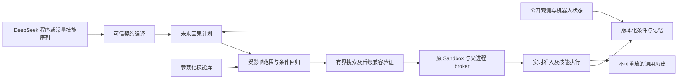

# CaP-X V29：自动因果构图与局部计划修复开发报告

正式目录 `/home/hanyu/dqb/cap-x-20261106`，分支 `feature/graph-complete-20261120`，起点 `9c7813f`。开始时工作区干净；本轮修改尚未提交。历史实验未重写。

**结论：可运行原型、机制验证和真实模型对照已完成；完整 PickPlace 成功率没有提高，新增自动因果边的独立线上收益尚未得到支持。暂不扩大正式评测。** 确定性续接减少了恢复模型请求，选择性补证减少了部分 GraspNet / IK 工作；这些收益不能全部归因于 V29 的自动因果构图。

本地产物根目录（下文 RUN）：`outputs/model_comparison/graph_v29_20261124_173441`。原始观测、视频、模型请求、物理 Trace、源码归档和失败结果留在本地，不随源码提交。

## 1. 实现与 LOGIV 的关系

阅读并归档了 [LOGIV 提交 0ea7a7f](https://github.com/Enqiao-Lu/LOGIV/tree/0ea7a7ff765016a33409c54572d733bed4503d4d/logiv/core) 的 `symbolic.py`、`graph.py`、`repair.py`、`execution.py`。吸收 live causal support、affected/replaced 分离、保留后缀条件回归及验证后拼接的思路。没有引入其仿真器、PDDL 工具链、VAL、GNN 或模型，也不声称复现 LOGIV 论文结果。

在已有 ContractGraph / DependencyGraph 上增加以下能力：

- **自动编译实际模型程序。** 根据前置条件、建立/破坏效果、证据失效、资源及显式数据输入推导支持、证据、冲突和资源关系。区域搬运任务不再预写 acquire→deposit 的 `after`；必要的显式顺序仍可保留。
- **可信技能库。** 有限对象/目标绑定和参数化契约由父进程提供，独立于模型选择的初始顺序。修复搜索可以组合库中未出现在初始 intent 序列里的技能。
- **三值语义。** TRUE / FALSE / UNKNOWN 明确区分；负前置条件需要明确 FALSE。预测 add/delete 不会写成当前真值，实际效果由原 verifier 决定。
- **局部修复。** 区分受影响节点与停止后必须替换的节点；回归保留后缀，通过有界代价搜索生成片段，验证片段与后缀整体兼容，检查状态版本和在途资源后提交。新动作使用新 ID；已完成调用历史不可重开。
- **运行时增量关联。** 新观测通过 `live_causal_support` 关联未来动作，实际调用通过 `causal_execution` 关联计划节点；保留所有计划版本和 `causal_patch`。
- **接回现有执行链。** 已验证的续接代码仍进入原 Sandbox、broker 和 Skill 内部检查。初始/必要恢复由真实 DeepSeek 生成；确定性续接在产物中标为 `deterministic_verified_plan`，不冒充模型输出。
- **保留 V28。** 精确输入缓存、当前深度重投影、计划运动版本、共享观测及代价补证不变。未来才消费的工具几何可以延迟补证，但仍列入后续动作的验证义务，不把 UNKNOWN 提前授权为 TRUE。

搜索限制为最多 512 次状态展开、深度 6、3 次范围扩展；物理修复计入原预算。G0 同样获得技能库搜索和确定性续接，采用保守后缀补证；G1 的差别是因果支持、影响范围和选择性决策。核心新增代码不按任务名、对象名、颜色、Seed 或故障标签分派动作。物理评分、运动安全阈值和 Sandbox 边界未修改。

## 2. 机制验证和工程修正

`tests/graph_v2/test_v29_causal_repair.py` 覆盖：无人工 after 构图、资源/数据依赖、负条件、预测与实证分离、历史不可重放、新对象绑定、多步库搜索、后缀冲突、原子提交、证据版本变化、UNKNOWN 与能力不足、有界搜索和消融差异。

`symbolic-final/` 是**精确符号夹具，不是仿真、Vision 或 DeepSeek 物理实验**。支撑失效且资源被持物占用后，搜索组合 `park → align → take`，再续接原 `assemble → peer`。两个策略均完成，共 5 次符号调用；G1 定位一个受影响分支，保守策略定位两个，但**没有减少实际调用数量，不能以节点数声称收益**。

开发中保留并修复了两个问题：

1. 全后缀回归过早要求未来抓取几何，导致预先计算随运动过期的计划。现将未立即消费的工具证据保留为未来验证义务，当前动作仍须补齐证据。
2. 真实 DeepSeek 在物理扰动单元生成了常量列表＋for 循环，第一版编译器拒绝了两个配对 episode。现支持严格受限的常量列表/元组单层循环；拒绝动态迭代、分支、循环体修改、重赋值和 for-else。两个拒绝记录保留，之后用**本轮同一初始模型程序和 Snapshot、零新增初始请求**复跑，不换 Seed 或 Oracle。

测试记录：

- 配置正确的全量 Graph＋P0：**1223 passed / 0 skipped / 0 failed**，包括真实 P0 Vision、Reward Worker、Snapshot 和 6 个渲染测试。
- 后续负条件支持及常量列表兼容修正：专项 **89 passed**；与全量去重后累计 **1225 个不同测试通过**。不把重复运行相加。
- 早期一次回归因编辑与冻结测试重叠触发源码漂移，已中断并留日志；另两项 P0 失败请求了旧 IK `8116`，明确为连接失败。使用已在线的 runtime 配置后通过，没有改依赖或降低断言。

## 3. 实验规模、版本和公平性

共保留 **22 条 episode 记录**：开发 smoke 3 条；首个冻结批次 14 条；编译兼容修复后的物理扰动 G0/G1 及必要消融 5 条。

首个冻结批次中：正常 Seed 0 为 3 组；证据过期 Seed 0 为 7 组；物理扰动 2 组在编译前拒绝；正常 Seed 21 为 2 组，在真实观测后的动作准入处拒绝。后两类拒绝保留，未冒充已执行物理动作。

修复后的 5 条物理扰动记录独立归档于 `physical0-compiler-fix/` 和 `physical0-compiler-ablations/`。两目录运行源码哈希相同，沿用本轮 `final-physical0/initial.json`；初始程序不是新一次生成，后续恢复请求则按实际调用记录。

每个单元内完整 Snapshot、初始程序 hash、任务信息、Prompt、技能、安全阈值和预算一致，源码运行前后检查均无漂移。主配置每 episode 为 24 Skill、256 API、1200 秒、12 个代码块、12 次补证、6 次修复；每单元 24 次模型请求、估价 US$5、7200 秒。DeepSeek 输出上限 32768，reasoning effort=low。

V28 对照是在当前共同契约/技能上使用 V28 执行策略，**不是历史源码完整检出**。下表时间为实际 episode 执行，排除共享初始生成等待，包含追加恢复请求；只作本次描述，不能用单次耗时推断总体加速比。

## 4. 真实 DeepSeek＋Vision 结果

### 正常分布

Seed 0：G0、G1、V28 均完成 **1/4**，完整成功均为否。三组 SAM3=136、GraspNet=2、IK=27；capture 分别 29、30、28，执行约 44.15、44.14、43.68 秒。没有图收益，G1 多做了 capture。

Seed 21：G0/G1 均 **0/4**，SAM3=2、capture=3，无实际运动，均因公开容器/前置证据不足退出。不能拿这种早退与推进到 1/4 的成本直接比较。

### 证据过期：同一已完成目标的证据撤销

所有组最终 **1/4**，完整成功均为否；均重新验证了已完成效果，继续执行到下一物体，随后遭遇相同 TCP 收敛阻断及容器边界不足。所有组 SAM3 实际请求均为 **136**，没有 V29 新增的 SAM3 节省。

| 组 | GraspNet | IK | capture | 模型请求（含共享初始） | 执行秒 |
|---|---:|---:|---:|---:|---:|
| G0 | 5 | 53 | 31 | 1 | 49.40 |
| G1 | 2 | 27 | 33 | 1 | 44.81 |
| no_causal | 2 | 27 | 33 | 1 | 46.45 |
| no_local_repair | 2 | 27 | 32 | 2 | 56.56 |
| no_resume_validation | 2 | 27 | 33 | 1 | 44.75 |
| no_cost | 2 | 27 | 31 | 1 | 44.38 |
| V28-G1 | 2 | 27 | 32 | 2 | 54.03 |

G0/G1 的 **21 次实际运动调用、参数及前后物理记录完全一致**，总 API 调用均为 24。因此 GraspNet 5→2、IK 53→27 不是靠减少物理进展取得。G1 延后了未消费的 Can/Cereal 抓取计划，实际复用一次有效计划；G0 提前计算的部分计划随后过期。SAM3 额外逻辑查询通过共同精确缓存复用，没有重复 HTTP 输入。

但 no_causal 与 G1 的计数相同，V28 已具备相同 GraspNet/IK 成本：**这些数据支持选择性补证，不能证明新增自动因果边的独立价值。** no_cost 少 2 次 capture 且工具计数不变，本例的代价排序有额外开销。

真实提交的局部 patch 保留了剩余 intent，新增物理片段长度为 0；它完成的是补证后的确定性续接。多动作物理修复的成功证据仍只有前述符号夹具。

### 真实物理扰动：已完成物体被施加外力

以下为编译修复后的同版本比较，五组均实际施加配置中的有限外力，原生任务进展最后均为 **0/4**，完整成功均为否。故障物理数据仅在离线评价通道，`actor_received_private_state=false`。

| 组 | SAM3 | GraspNet | IK | capture | 模型请求 | 执行秒 |
|---|---:|---:|---:|---:|---:|---:|
| G0 | 167 | 7 | 110 | 33 | 3 | 155.09 |
| G1 | 157 | 2 | 42 | 30 | 1 | 51.01 |
| no_causal | 157 | 2 | 42 | 30 | 1 | 51.66 |
| no_local_repair | 157 | 2 | 42 | 31 | 2 | 65.73 |
| V28-G1 | 157 | 2 | 42 | 31 | 2 | 58.19 |

G0/G1 最终都处于 `closed_unverified`；持物注册不足，无法安全释放。两组 **21 次运动命令及参数一致**，物理轨迹有微小数值差异，不能宣称逐 bit 一致。G0 额外请求模型尝试 deposit 和再次补证，均未获得运动许可；新增 2 次模型请求耗时约 92.51 秒，是大部分时间差的来源。

G1 没有修复已位移的目标，也没有确认当前抓持；它以 `no_legal_recovery_capability` 有界退出。V28 与 no_causal 的结果再次说明：当前收益主要来自已有选择性条件规划和确定性续接，尚不是自动因果边带来的物理恢复优势。

## 5. 成本、证据和限制

全部开发、失败和补跑合计 **11 次实际 DeepSeek 请求**，HTTP 全为 200，requested/response model 均为 `deepseek-v4-pro`，finish_reason 全为 stop，attempts 全为 1。

输入 **53,970 token**；输出 **10,667 token**，其中 reasoning **10,106**（包含在输出内，不重复相加）。项目保守估价合计 **US$0.11348172**，不是服务商账单。共享初始请求按唯一 receipt 计费，不按配对组重复计费。没有训练、模型下载或真实机器人操作。

关键证据：

- `completion-audit.json`：所有单元、费用、API 状态、测试去重、配置权限及秘密扫描。
- `regression-final.xml/log`、`negative-support-regression.xml/log`、`compiler-final.xml/log`：测试与补验；其余早期失败日志保留。
- `final-evidence0-analysis.json`、`final-evidence0-perception.json`：真实 HTTP、缓存及恢复成本归因。
- `physical0-compiler-fix-analysis.json`、`physical0-compiler-ablations-analysis.json`：真实物理故障成本。
- 各组 `trace.jsonl`、`contract-graph.json`、`actor-*-program.json`、`actor-*-public.json`、视频、Snapshot、请求 receipt；`source-archive.json` 固定运行字节。

`.env.local` 和 `.env.api.local` 仍为 0600；已扫描 5067 个文本实验文件，未发现配置密钥值。SAM3/GraspNet 和原 CPU IK 继续使用，未停止其他项目进程。NVML 的驱动/库不匹配仍存在，本轮沿用软件 EGL 和 CPU IK，没有动系统依赖。

尚未解决：

1. 没有完整 PickPlace 成功，也没有由库搜索出的新多动作片段完成真实物理修复；不能把符号成功或证据刷新算成物理恢复。
2. 现有 Vision 能力仍会遇到 TCP 不收敛、容器边界缺失和持物注册不确定。最早阻断位置已记录，控制误差的更底层成因尚未证明。
3. 新对象/技能组合只验证了逻辑通用性，没有证明未见物体的 Vision 能力。运行库仍是已接入的 acquire/deposit，不存在凭空合格的暂放/支撑修复技能。
4. 自动因果构图和续接验证在机制反例中发挥作用，在线消融尚未激活可带来成功率提升的对应情形；不报告虚假的贡献。
5. 只有两个固定开发 Seed，压力测试复用 Seed 0，组序固定；不估计总体成功率提升或统计显著性。图搜索的 CPU 时间未独立计时，包含在端到端时间内。

**判断：可继续有限机制开发；正式扩大评测 NO-GO。** 下一步应在公开感知能够确认、已有安全能力能够恢复的物理条件上构造同能力对照，证明真实组合修复和自动边的增量价值，再谈扩大规模。

## 6. 修改清单和复跑

新增：`capx/execution/causal_plan.py`、`tests/graph_v2/test_v29_causal_repair.py`、`scripts/local/causal_mechanism_gate.py`、`env_configs/graph_feedback/development-v29.json`、V29 说明和本报告。

修改：`graph_executive.py` 接入编译/修复；`skill_contracts.py` 接入负条件、数据条件、实证删除和运行时图关联；`contract_models.py` 接入确定性续接、消融及真实模型来源记录；`native_vision_skills.py` 提供参数化能力库并去除预设 after；`analyze_contract_models.py` 支持 V29；README 添加入口。

实际可执行命令见 [V29 使用说明](../feedback/graph-v29.md)。无需升级依赖、下载模型或改变物理评分。
